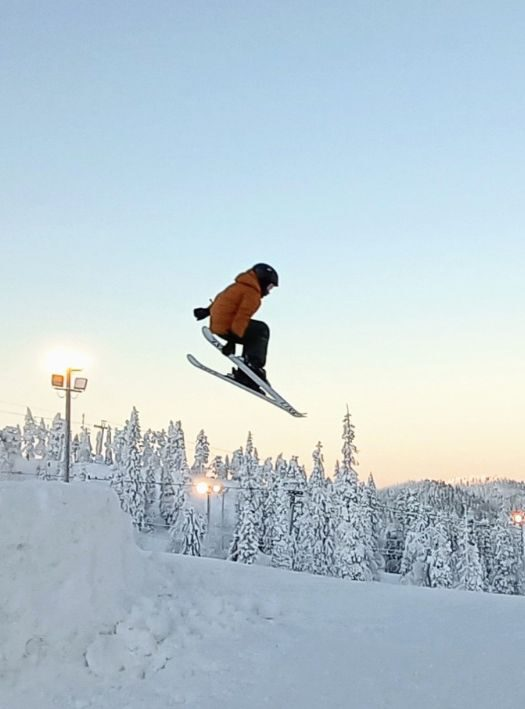
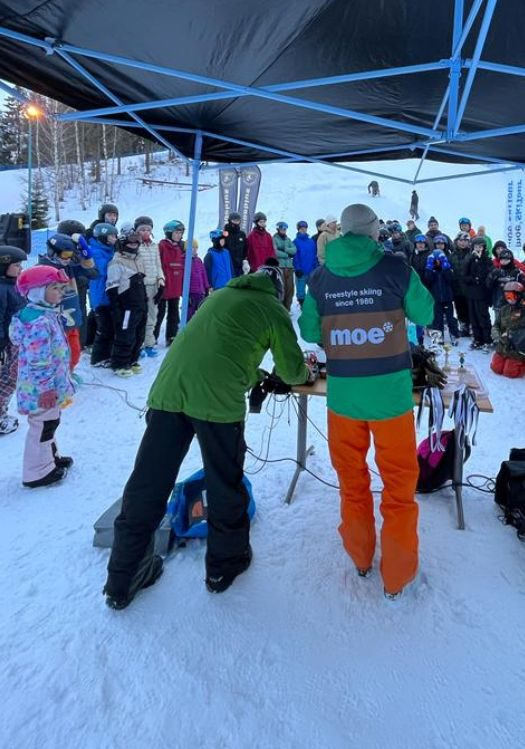

## Valmennuksen perusteet

Moebius tarjoaa lapsille ja nuorille innostavaa nuorten tarpeista kumpuavaa seuratoimintaa freestylehiihdon parissa. Seura rakentaa valmennustoimintaa jäsenkunnan tarpeiden mukaan. Tavoitteena on tarjota kaikille omalle taitotasolle sopivan haastavaa ja innostavaa toimintaa. Valmennus ja kilpailutoiminta luovat jokaiselle innokkaalle seuran jäsenelle vahvat freestylen perustaidot, jonka pohjalta lajia voi harrastaa mahdollisimman turvallisesti koko ajan kehittyen. Yhteisöllisyys on seuran kantava arvo. Seura panostaa niin lasten, valmentajien ja vanhempien innostavaan ilmapiiriin.

## Valmentajat

Valmennuksesta vastaavat niin freeski-lajikokemusta kuin kumparelaskukokemusta omaavat valmentajat. Apuvalmentajina toimii usein itse vielä aktiiviurallaan olevia urheilijoita.

## Lajiesittely

[Freeski (Slopestyle / Big Air / Halfpipe)](https://www.ski.fi/skisport/harrastaminen/freestylehiihto/)

[Kumparelasku](https://www.ski.fi/skisport/harrastaminen/kumparelasku-ja-hypyt/)

## Ohjattu harjoittelu

Seura järjestää mahdollisuuden ohjattuun harjoitteluun 1-4 kertaa viikossa lumikaudella ja 1-2 kertaa muina aikoina. Seura tarjoaa monipuolisia lajiharjoituksia parkki- ja kumparelaskuteemalla.

Hyväksi freestylehiihtäjäksi voi kasvaa vain harrastamalla lajia ja tekemällä runsaasti lajia tukevaa taitoharjoittelua. Kaikilla jäsenille suositellaan kausikorttia lähirinteeseen ja runsaasti omatoimista harjoittelua. Lisäksi kaikkia seuran harrastajia kannustetaan harrastamaan mahdollisimman paljon muuta liikuntaa ja urheilua niin omatoimisesti kuin muissa urheiluseuroissa.

Seuramme järjestää viikkoharjoituksia talvikaudella Sipoon Talmassa, Hyvinkään Sveitsissä ja Espoon Serenassa.

Freestyleseura Moebiuksen valmennustoiminta on ympärivuotista. Pääpaino harjoittelussa on talven lumitreeneissä, mutta myös lumettomalla kaudella on harjoitustoimintaa.

Oheisvalmennusta järjestetään keväällä ja syksyllä esimerkiksi Eläintarhan yleisurheilukentällä tai Tammiston SuperParkissa. Lisäksi voi olla yksittäisiä tai lyhyempiä erikoisvalmennuksia, kuten vesihyppyleirejä.\
Kaikista valmennuksista sekä kustannuksista ilmoitetaan siinä vaiheessa kun pyydetään urheilijoita ilmoittautumaan mukaan. Valmennusmaksu kattaa mahdollisen tilavuokran sekä valmennuksen. Talvikauden valmennus hiihtokeskuksissa ei sisällä hissilippua.

<Band image="sjflsj2.png" heading="Kilpailutoiminta" />

Moebius on sekä kilpa- että harrasteurheiluseura. Kaikille tarjotaan treenien lisäksi mahdollisuutta matalan kynnyksen kilpailutoimintaan. Moebius mahdollistaa myös kansainväliseen huippu-urheiluun tähtäävän polun kilpaurheilusta kiinnostuneille aina noin 15-vuotiaaksi asti. Sen jälkeen tavoitteellisen nuoren urheilijan on mahdollista hakeutua lajin kansallisiin valmennuskeskuksiin opiskelemaan ja urheilemaan. Seurasta on kasvanut innokkaiden harrastajien lisäksi myös useita kansainvälisen tason urheilijoita aivan maailman huipulle.

## Moe Ski Tour

Freestyleseura Moebius järjestää mahdollisuuksien mukaan kaikille freestylehiihdosta kiinnostuneille avoimet kilpailut pääkaupunkiseudun laskettelukeskuksissa.

Moe Ski Tourilla ei vaadita seurajäsenyyttä eikä kilpailulisenssiä, ainoastaan voimassa oleva vakuutus. Kuka tahansa juniori-ikäinen voi lähteä mukaan kokeilemaan kisaamista. Moebiuksen jäsen ei maksa osallistumismaksua, muilta peritään pieni osallistumismaksu.

Ajankohtaiset kilpailut [SkiTour-sivulla](/skitour-2024/).

## Fearless Finns Freeski Tour

Ski Sport Finland ry koordinoi valtakunnallista Fearless Finns Freeski Touria, jossa osallistujan oltava freestyle- tai alppiseuran jäsen, vakuutettu sekä Skipassin tai lisenssin haltija. Osakilpailuja järjestetään eri hiihtokeskuksissa ympäri Suomen. Moebius maksaa/korvaa jäsenensä kilpailumaksut.\
Ski Sport Finland ry ilmoittaa kauden kisoista [omilla sivuillaan.](https://www.ski.fi/skisport/kalenteri-ja-tapahtuma/kalenterit/kauden-2021-2022-kilpailut-kotimaassa/)

## Lisenssit

Jos urheilija aikoo osallistua kansalliseen kilpailutoimintaan, hänen on lunastettava Skipassi tai kilpailulisenssi.

Skipassi on jokaisen hiihtolajin harrastajan edullinen, vakuutuksen sisältävä, lisenssituote, joka oikeuttaa 12-vuotiaat ja nuoremmat osallistumaan kaikkeen kansalliseen kilpailutoimintaan. Yli 12-vuotiaat saavat osallistua Skipassilla oman seuransa järjestämiin kilpailuihin, ei kuitenkaan SM-kilpailuihin.

Kilpailulisenssi on pakollinen kansalliseen ja sitä ylempään kilpailutoimintaan osallistuville yli 12-vuotiaille. Kilpailulisenssin voi ostaa vakuutuksen kanssa tai ilman (varmistettava että urheilijalla on oma urheilun harrastus- ja kilpailutoiminnan kattava vakuutus, jos ostaa lisenssin ilman vakuutusta).

## Leirit

Seura järjestää kaksi leiriä Rukalla kauden aikana. Lisäksi Moen jäsenillä voi olla mahdollisuus osallistua muille leireille, esimerkiksi vesihyppyleireille tai kumpareleireille.

## Kuvia

<Gallery images={["500335moebiusfreestyleskiing5.jpg", "500335moebiusfreestyleskiing4.jpg", "500335moebiusfreestyleskiing3.jpg", "500335moebiusfreestyleskiing2.jpg"]} />

<Button href="/kuvagalleria/">Katso lisää kuvia</Button>
