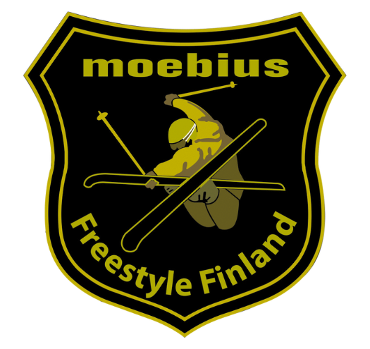

Freestyleseura Moebius ry is a non-profit ski club in the greater Helsinki area that organizes activities in freestyle skiing. The club provides high-quality coaching to both recreational and competitive freestyle skiers in a fun and supportive environment. The goal is to develop a strong technical base in freestyle skiing to allow for continued development in a safe manner. Skiers and parents alike enjoy the sense of community that is built though training activities, competitions, and camps. Club skiers have gone on to excel at both national and international level freestyle competitions.

The club offers year-round programming, on snow during the winter at Sipoo’s Talma and Espoo’s Serena, as well as camps at Ruka-Kuusamo. During the spring, summer, and fall members can participate in a variety of training opportunities including water-ramp and trampoline practice.

**Want to join?**

1\. [Join the club on myClub](https://moebius.myclub.fi/login) and complete all the fields, including the guardian’s information.\
2\. Register for winter practice in the myClub. All times and places are updated to the myClub.

Alternatively, you can express your interest by email (info@moebius.fi) and attend one practice before officially joining. Please note that you must have personal insurance that covers freestyle skiing.

For additional information please contact us at info@moebius.fi

<Gallery images={["moebiuskieli2.jpg", "moebiuskieli1.jpg", "moebiuskiei3.jpg"]} />
