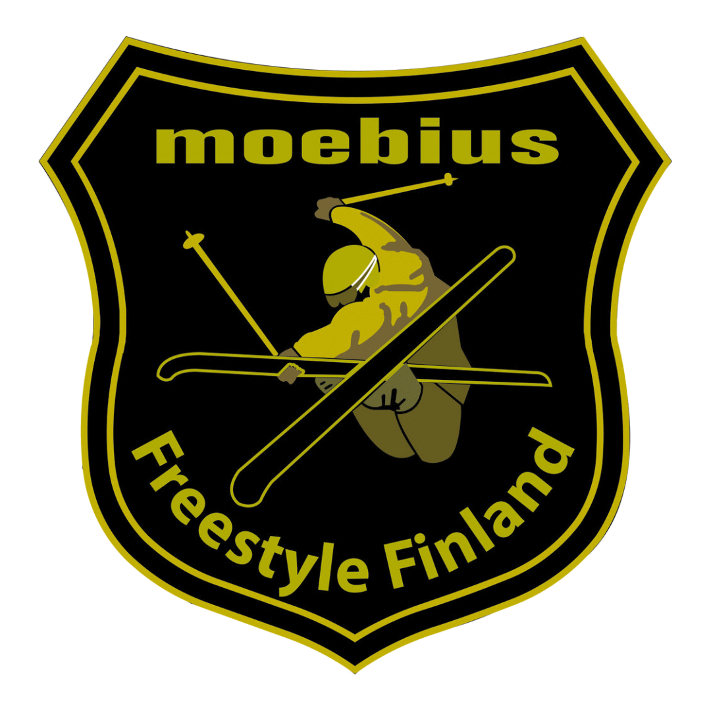
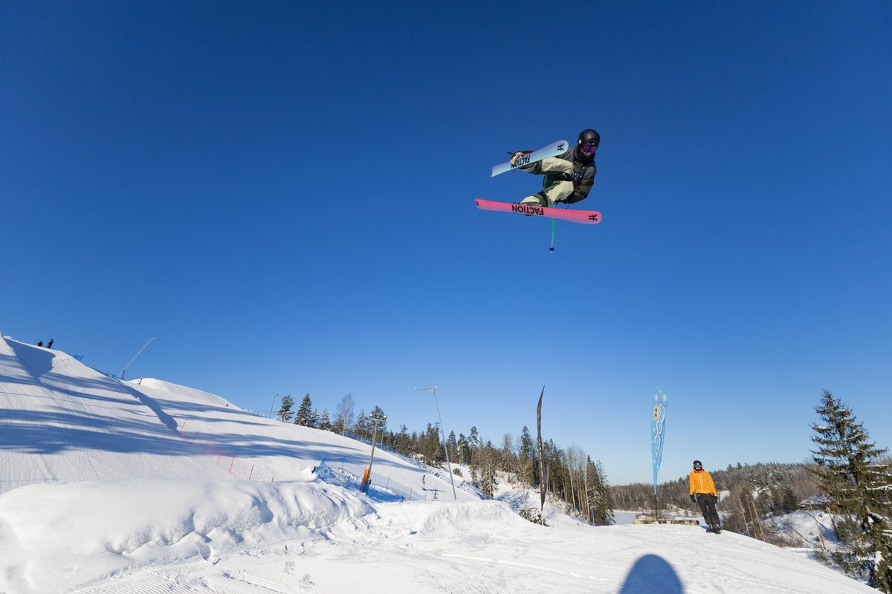
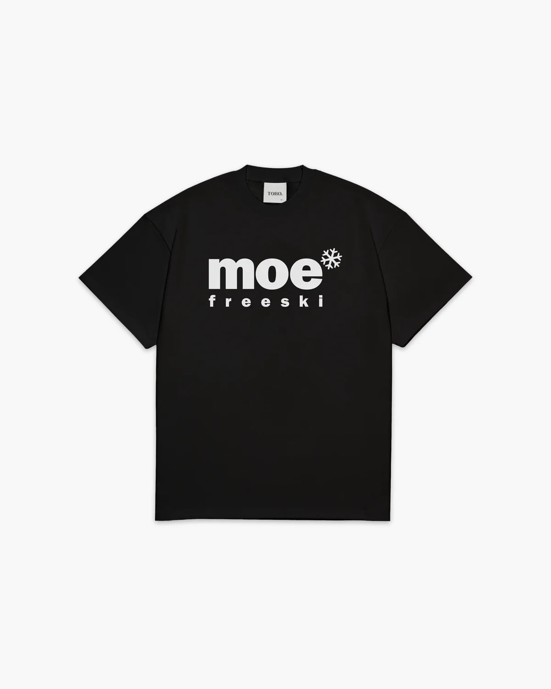

<Columns>

Freestyleseura Moebius ry on vuonna 1980 perustettu pääkaupunkiseudulla toimiva, perinteikäs freestyleseura. Seuran tavoitteena on tarjota jäsenilleen laadukasta toimintaa, haasteita, elämyksiä ja mukavaa yhdessäoloa freestylehiihdon parissa. Lisäksi seuramme tarjoaa jäsenilleen mahdollisuuden menestyä sekä kansallisen että kansainvälisen tason freestylekilpailuissa.

Moebius on Ski Sport Finland ry:n jäsenseura, joka organisoi sekä harrastus- että kilpailutoimintaa freestylehiihdon kaikissa kilpailulajeissa kysynnän mukaan: ski slopestyle, ski halfpipe, ski big air, kumparelasku sekä vapaalasku.

Seuramme järjestää liikuntapainotteista toimintaa ympäri vuoden sekä säännöllistä lajiharjoittelua talvikaudella Sipoon Talmassa, Espoon Serenassa sekä Hyvinkään Sveitsissä. Lisäksi pyrimme järjestämään mahdollisuuksien mukaan valmennus- ja kilpailutoimintaa lähialueen muissa hiihtokeskuksissa sekä Rukalla.

</Columns>

<Columns>

## Treenit talvikaudella

| Päivä | Paikka | Aika |
| --- | --- | --- |
| maanantai | Talma Ski | 18.30–20.00 |
| tiistai | Serena Ski | 18.30–20.00 |
| torstai | Talma Ski | 18.30–20.00 |
| perjantai | Serena Ski | 18.30–20.00 |
| sunnuntai | Sveitsin Hiihtokeskus | 16.00–17.30 |

Ilmoittautuminen treeneihin [myClubissa](https://moebius.myclub.fi/). 

[Lue lisää harjoittelusta >>](/harraste/)

## Moe SkiTour 2027

- 16.1. Talma Ski — Slopestyle
- 6.2. Serena Ski — Slopestyle ja kumpareet
- 6.3. Sveitsin Hiihtokeskus — Slopestyle
- 3.4. Talma Ski — Slopestyle

Avoin kaikille junioreille, ei vaadi lisenssiä eikä seurajäsenyyttä. 

[Kutsut ja tulokset >>](/skitour/)

</Columns>

<Band image="sjflsj2.png" heading="Haluatko mukaan?" />

<Columns>

## Liity jäseneksi

1\. Kun haluat liittyä seuran jäseneksi, rekisteröidy myClub-palvelun kautta kohdasta: [Rekisteröidy uudeksi jäseneksi.](https://moebius.myclub.fi/login) Täytä kaikki tarvittavat tiedot, myös huoltajan tiedot.\
2\. Ilmoittaudu talvikauden treeneihin myClubin kautta. Näet sieltä ajankohtaiset harjoitukset ja voit valita moneenko harjoitukseen osallistut.

Voit myös ilmoittautua mukaan sähköpostitse ([info@moebius.fi](mailto:info@moebius.fi?subject=Harjoituksiin%20ilmoittautuminen)), osallistua ensin yhteen harjoitukseen kokeilijana ja vasta sen jälkeen rekisteröityä jäseneksi ja virallisesti ilmoittautua treeneihin (edellyttää freestylehiihdon kattavan vakuutuksen).

## Vakuutukset

Varmistathan, että sinulla on vakuutus, joka kattaa laskettelun rinteessä. Jos aiot osallistua kansalliseen kilpailutoimintaan ja olet 12-vuotias tai nuorempi, voit lunastaa Hiihtoliiton Skipassin, joka on vakuutuksen sisältyvä lisenssituote.

Siinä vaiheessa kun olet yli 12-vuotias, taito karttuu ja kisanälkä kasvaa on varmistettava, että oma vakuutus kattaa myös freestylehiihdon. Eri vakuutusyhtiöillä on erilaiset käytännöt. Hiihtoliiton kilpailulisenssin voi lunastaa vakuutuksella tai ilman, katso: [Lisenssit](https://skisport.fi/lisenssit-skipassi/).

</Columns>

<Columns>

## Huippu-urheilu

Moebius mahdollistaa myös kansainväliseen huippu-urheiluun tähtäävän polun kilpaurheilusta kiinnostuneille. [Vuokatti-Ruka Urheiluakatemia](https://vrua.fi/lajit/freeski/) järjestää Kuusamossa sekä freeski-yläkoululeirejä että valmennusryhmiä 2. asteen opiskelijoille. Tästä kilpaura voi jatkua maajoukkueen haastajaryhmästä aina Suomen freeski-maajoukkueeseen.

Moebius onkin kasvattanut innokkaiden harrastajien lisäksi useita kansainvälisen tason urheilijoita aivan maailman huipulle (Europa Cup, World Cup, MM-kisat sekä nuorten ja aikuisten olympialaiset). [Lue lisää maajoukkuetoiminnasta >>](/maajoukkuetoiminta/)

</Columns>

<Columns>

## MOE verkkokauppa

MOE verkkokauppa on avattu! Seuran paidat ja muut tuotteet voi tilata Tobon verkkokaupasta.

[Siirry verkkokauppaan >>](https://tobo.fi/kauppa/moebius)

</Columns>

## Kuvia

<Gallery images={["ruka-2026-tuubi-aurinko.jpg", "ruka-2026-boksi-huurre.jpg", "serena-2026-kuulutus-videointi.jpg", "ruka-2026-lammittely.jpg"]} />

<Button href="/kuvagalleria/">Katso lisää kuvia</Button>

<Logos images={["rukaskiresortrgb.png", "pyhatunturirgb.jpg"]} large />
