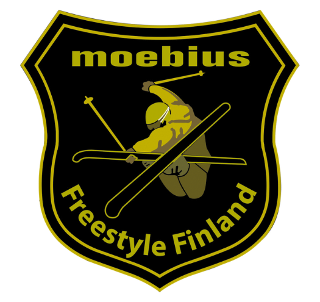

Freestyleföreningen Moebius rf är en allmännyttig förening som verkar i Helsingfors-regionen och erbjuder olika aktiviteter inom freestyleåkning. Föreningen erbjuder högklassig träningsverksamhet på olika nivåer och en trevlig och uppmuntrande gemenskap. Föreningens idrottare har klarat sig utmärkt på nationell och internationell nivå.

**Om våra träningar**

Föreningen erbjuder under vintermånaderna träningar i Tallmo (Talma) i Sibbo och Serena i Esbo. Under vintern ordnas det också läger på Ruka i Kuusamo. Under sommaren och hösten ordnas olika aktiviteter såsom trampolinträningar och fri-idrott.

**Kom med**

1\. [Fyll i medlemsansökan via myClub.](https://moebius.myclub.fi/login)Fyll i dina och vårdnadshavarens alla uppgifter.

2\. Anmäl dig till vinterträningarna. All aktuell information om träningar och övningar finns tillgänglig i myClub.

Du kan också kontakta oss via e-post (info@moebius.fi) och komma med och prova en gång innan du bestämmer dig för att bli medlem. Observera att du behöver ha en egen försäkring som täcker freestyle-åkning.

<Gallery images={["moebiuskieli2.jpg", "moebiuskieli1.jpg", "moebiuskiei3.jpg"]} />
