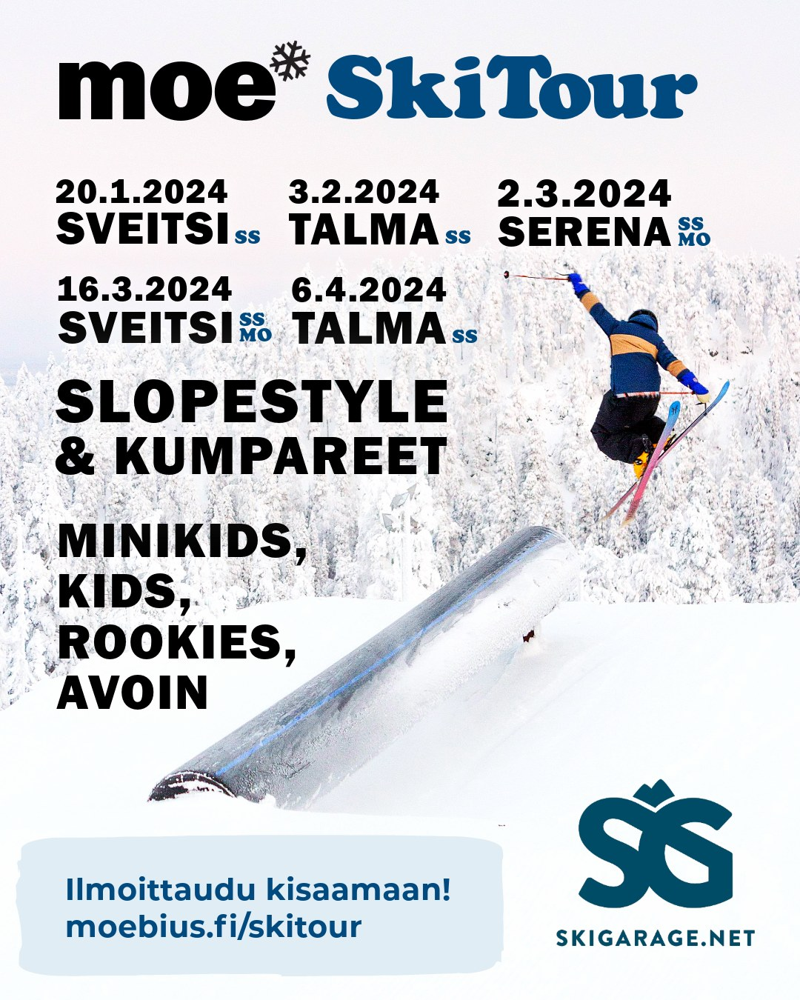

<Columns>

# SkiTour 2024

Kauden viisi osakilpailua:

- 20.1. Sveitsin Hiihtokeskus — Slopestyle
- 3.2. Talma Ski — Slopestyle
- 2.3. Serena Ski — Slopestyle ja kumpareet
- 16.3. Sveitsin Hiihtokeskus — Slopestyle ja kumpareet
- 6.4. Talma Ski — Slopestyle

Sarjat: MiniKids, Kids, Rookies ja Avoin.

</Columns>

# SkiTour 2024 kokonaistulokset

SkiTour sijoittuminen vaati osallistumista kahteen tai useampaan kilpailuun.

<Wide>

## Kids pojat

| Sija | Nimi | Sveitsi 20.1. | Talma 3.2. | Serena 2.3. | Sveitsi 16.3. | Talma 6.4. | Seura | Yhteensä |
| ---: | --- | ---: | ---: | ---: | ---: | ---: | --- | ---: |
| 1 | Karlo Kauppinen | 10 | 15 | 26 | 31 | 1 | Moebius | 83 |
| 2 | Niklas Heikkinen | 14 | | 20 | 24 | 9 | Moebius | 67 |
| 3 | Leonard Elfström | 9 | 13 | 9 | 21 | 11 | FK-37 | 63 |
| 4 | Otso Weckström | 15 | | 22 | 26 | | Moebius | 63 |
| 5 | Nelson Railo | 12 | 14 | 10 | 18 | 3 | FK-37 | 57 |
| 5 | Miro Laaksonen | 11 | 12 | 15 | 14 | 5 | Moebius | 57 |
| 7 | Leo Junnola | | 11 | 19 | 25 | | Moebius | 55 |
| 8 | Kasper Kadenius | 13 | 7 | 13 | 19 | | Moebius | 52 |
| 9 | Nuutti Rauhala | 5 | | 21 | 22 | | Moebius | 48 |
| 10 | Tony Havia | | 16 | 18 | | 12 | Moebius | 46 |
| 11 | Aatos Simola | 8 | 9 | 9 | 4 | | Moebius | 30 |
| 12 | Emil Stolt | | | 14 | 16 | | Moebius | 30 |
| 13 | Verneri Korpinen | | | 19 | 9 | | JFS | 28 |
| 14 | Kim Valkeapää | | 4 | 12 | 5 | 5 | Moebius | 26 |
| 15 | Peetu Rutanen | | | 11 | 15 | | JFS | 26 |
| 16 | Severin Virkkunen | 4 | 8 | 6 | 3 | 2 | FK-37 | 23 |
| 17 | Victor Wennerqvist | | 10 | | | 10 | Moebius | 20 |
| 18 | Miko Ketonen | 7 | | | 9 | | Ei seuraa | 16 |
| 19 | Mauno Honkanen | | | 6 | 8 | | JFS | 14 |
| 20 | Mikael Mäkinen | 3 | 3 | 5 | | | Moebius | 11 |
| 21 | Kasperi Heikkilä | | | | 1 | 6 | Moebius | 7 |

## Kids tytöt

| Sija | Nimi | Sveitsi 20.1. | Talma 3.2. | Serena 2.3. | Sveitsi 16.3. | Talma 6.4. | Seura | Yhteensä |
| ---: | --- | ---: | ---: | ---: | ---: | ---: | --- | ---: |
| 1 | Estella Holmbom | 1 | 1 | 1 | | 1 | Moebius | 4 |
| 2 | Lisette Marie Letner | | | | 1 | 2 | Estonia | 3 |

## Rookie pojat

| Sija | Nimi | Sveitsi 20.1. | Talma 3.2. | Serena 2.3. | Sveitsi 16.3. | Talma 6.4. | Seura | Yhteensä |
| ---: | --- | ---: | ---: | ---: | ---: | ---: | --- | ---: |
| 1 | Max Sallinen | 16 | 11 | 24 | 16 | 17 | Moebius | 84 |
| 2 | Kaius Kaila | 15 | 15 | 24 | 12 | 16 | Moebius | 82 |
| 3 | Melvin Sandman | 14 | 16 | 16 | 17 | 9 | Moebius | 72 |
| 4 | Kalle Laaksonen | 11 | 10 | 11 | 9 | 13 | Moebius | 54 |
| 5 | Julius Ahtokari | 13 | 14 | | 13 | 12 | Moebius | 52 |
| 6 | Eeka Rantanen | 9 | 5 | 4 | 6 | 15 | Moebius | 39 |
| 7 | Aapo Särkinen | | 13 | 15 | 11 | | ei seuraa | 39 |
| 8 | Oula Männistö | 10 | 3 | 11 | | 12 | Moebius | 36 |
| 9 | Aati Aalto | 1 | | 18 | 4 | 10 | Moebius | 33 |
| 10 | Jose-Valtteri Varis | | 12 | 7 | 7 | | Moebius | 26 |
| 11 | Sami Bertling | 8 | 9 | 1 | | 7 | Moebius | 25 |
| 12 | Heikki Jalkanen | | 6 | 5 | 10 | | Moebius | 21 |
| 13 | Lasse Lipponen | 8 | 7 | 2 | 2 | 1 | Moebius | 20 |
| 14 | Joonatan Rautiala | | | 15 | 4 | | Moebius | 19 |
| 15 | Niko Sheng | 6 | 8 | 1 | | | Moebius | 15 |
| 16 | Wolter Tuomainen | 12 | 1 | | | | Moebius | 13 |
| 17 | Max Ylitalo | | | | 6 | 6 | TSS | 12 |
| 18 | Mio Kallis | 3 | 2 | 4 | | | Moebius | 9 |

## Rookie tytöt

| Sija | Nimi | Sveitsi 20.1. | Talma 3.2. | Serena 2.3. | Sveitsi 16.3. | Talma 6.4. | Seura | Yhteensä |
| ---: | --- | ---: | ---: | ---: | ---: | ---: | --- | ---: |
| 1 | Maisa Rauhala | 1 | 1 | | 2 | 2 | Moebius | 6 |
| 2 | Tindra Holmbom | | 2 | 1 | 1 | 1 | Moebius | 5 |

## Pro pojat

| Sija | Nimi | Sveitsi 20.1. | Talma 3.2. | Serena 2.3. | Sveitsi 16.3. | Talma 6.4. | Seura | Yhteensä |
| ---: | --- | ---: | ---: | ---: | ---: | ---: | --- | ---: |
| 1 | Jami Viitanen | 2 | 1 | 4 | 2 | 4 | Moebius | 13 |
| 2 | Taavi Lopperi | 3 | | 1 | 3 | 6 | Moebius | 13 |
| 3 | Kristjan Kruusement | | 3 | | | 9 | Ei seuraa | 12 |
| 4 | Jonne Sahrman | | | | 4 | 7 | Moebius | 11 |
| 5 | Kristian Gröhn | 4 | | | 5 | | JFS | 9 |
| 6 | Mikael Laakso | | | | 1 | 8 | Meri-Teijon Alppiseura | 9 |

</Wide>

[<strong>Sveitsi 20.1.</strong>](#videot-ja-kuvat)

[<strong>Talma 3.2.</strong>](#moe-skitour-2024-tour-results)

[<strong>Serena 2.3.</strong>](#kilpailukutsu-moe-skitour-serena)

[<strong>Sveitsi 16.3.</strong>](#kilpailukutsu-fearless-finns-ja-moe-skitour-sveitsin-hiihtokeskus-1632024)

[<strong>Talma 6.4.</strong>](#moe-skitour-talma-642024)

# Moe SkiTour Talma 6.4.2024

Kilpailun johtaja Heikki Rauhala. Tuomarit Kim Sallinen, Joona Sipola ja Matias Suomi.

## MiniKids

| Bib | Etunimi | Sukunimi | Seura |
| ---: | --- | --- | --- |
| 12 | Kaaro | Veide | Mäesuusakool (EST) |
| 13 | Valtteri | Matilainen | Moebius |

## Kids tytöt

| Rank | Bib | Etunimi | Sukunimi | Seura | Run 1 | Run 2 | Best run |
| ---: | ---: | --- | --- | --- | ---: | ---: | ---: |
| 1 | 64 | Lisette | Letner | | 81,3 | 73,3 | 81,3 |
| 2 | 14 | Estella | Holmbom | Moebius | 59,3 | 56,3 | 59,3 |

## Kids pojat

| Rank | Bib | Etunimi | Sukunimi | Seura | Run 1 | Run 2 | Best run |
| ---: | ---: | --- | --- | --- | ---: | ---: | ---: |
| 1 | 25 | Lucas | Virman | Moebius | 86,7 | 71,3 | 86,7 |
| 2 | 26 | Tony | Havia | Moebius | 70,7 | 71,7 | 71,7 |
| 3 | 29 | Leonard | Elfström | FK-37 | 70,7 | 64,3 | 70,7 |
| 4 | 27 | Victor | Wennerqvist | Moebius | 57,7 | 70,3 | 70,3 |
| 5 | 30 | Niklas | Heikkinen | Moebius | 60,7 | 67,0 | 67,0 |
| 6 | 20 | Riku | Kainulainen | Moebius | 65,0 | 15,0 | 65,0 |
| 7 | 23 | Frederik | Laast-Laas | Lumeakadeemia (Est) | 64,0 | 47,3 | 64,0 |
| 8 | 17 | Kasperi | Heikkilä | Moebius | 11,0 | 63,3 | 63,3 |
| 9 | 18 | Kim | Valkeapää | Moebius | 60,7 | 62,3 | 62,3 |
| 9 | 21 | Miro | Laaksonen | Moebius | 62,3 | 60,3 | 62,3 |
| 11 | 28 | Nelson | Railo | FK-37 | 52,3 | 55,0 | 55,0 |
| 12 | 22 | Severin | Virkkunen | FK-37 | 48,7 | 51,0 | 51,0 |
| 13 | 15 | Karlo | Kauppinen | Moebius | 26,0 | 16,7 | 26,0 |

## Rookies tytöt

| Rank | Bib | Etunimi | Sukunimi | Seura | Run 1 | Run 2 | Best run |
| ---: | ---: | --- | --- | --- | ---: | ---: | ---: |
| 1 | 32 | Maisa | Rauhala | Moebius | 59,7 | 66,7 | 66,7 |
| 2 | 33 | Tindra | Holmbom | Moebius | 41,3 | 63,7 | 63,7 |
| 3 | 66 | Amanda | Eskelin | | 22,0 | 39,0 | 39,0 |

## Rookies pojat

| Rank | Bib | Etunimi | Sukunimi | Seura | Run 1 | Run 2 | Best run |
| ---: | ---: | --- | --- | --- | ---: | ---: | ---: |
| 1 | 41 | Max | Sallinen | Moebius | 76,0 | 61,0 | 76,0 |
| 2 | 43 | Kaius | Kaila | Moebius | 74,7 | 24,7 | 74,7 |
| 3 | 51 | Eeka | Rantanen | Moebius | 58,7 | 74,0 | 74,0 |
| 4 | 49 | Karl Kristjan | Kotka | Moebius | 26,7 | 73,7 | 73,7 |
| 5 | 42 | Kalle | Laaksonen | Moebius | 71,3 | 20,3 | 71,3 |
| 6 | 50 | Julius | Ahtokari | Moebius | 33,0 | 71,0 | 71,0 |
| 6 | 53 | Oula | Männistö | Moebius | 69,0 | 71,0 | 71,0 |
| 8 | 35 | Aati | Aalto | Moebius | 27,7 | 70,0 | 70,0 |
| 9 | 54 | Melvin | Sandman | Moebius | 64,3 | 64,3 | 64,3 |
| 10 | 46 | Oliver | Aabreldaal | Lumeakadeemia | 47,0 | 54,7 | 54,7 |
| 11 | 39 | Sami | Bertling | Moebius | 45,7 | 17,0 | 45,7 |
| 12 | 45 | Max | Ylitalo | TSS | 42,0 | 18,3 | 42,0 |
| 13 | 55 | Manu | Kalke | Moebius | 36,3 | 38,0 | 38,0 |
| 14 | 37 | Tristian | Evert | Moebius | 23,3 | 19,0 | 23,3 |
| 14 | 38 | Joonas | Lappalainen | Moebius | 6,3 | 23,3 | 23,3 |
| 16 | 34 | Cirocco Dominick | Pikkor | Moebius | 23,0 | 21,7 | 23,0 |
| 17 | 48 | Lasse | Lipponen | Moebius | 17,3 | DNS | 17,3 |

## Pros

| Rank | Bib | Etunimi | Sukunimi | Seura | Run 1 | Run 2 | Best run |
| ---: | ---: | --- | --- | --- | ---: | ---: | ---: |
| 1 | 65 | Elias | Liikanen | | 89,7 | 83,3 | 89,7 |
| 2 | 57 | Kristjan | Kruusement | Moebius | 71,3 | 31,0 | 71,3 |
| 3 | 58 | Mikael | Laakso | Meri-Teijon Alppiseura | 18,7 | 64,3 | 64,3 |
| 4 | 56 | Jonne | Sahrman | Moebius | 42,3 | 61,3 | 61,3 |
| 5 | 63 | Taavi | Lopperi | Moebius | 61,0 | 43,0 | 61,0 |
| 6 | 62 | Iivo | Vesikko | TSS (Tampereen slalom seura) | 16,3 | 57,0 | 57,0 |
| 7 | 60 | Jami | Viitanen | Moebius | 39,3 | 25,0 | 39,3 |
| 8 | 59 | Oliver | Teirikari | Ei ole seuraa | 7,7 | 35,7 | 35,7 |
| 9 | 61 | Ahti | Laine | ei ole | 30,7 | 30,0 | 30,7 |
| 10 | 67 | Mihkel | Murrand | | 23,7 | 22,0 | 23,7 |

# Kilpailukutsu Moe SkiTour Talma 6.4.2024

Tervetuloa Freestyleseura Moebius ry:n Moe SkiTour -kiertueen päätöskilpailuun Talma Ski:hin lauantaina 6.4.2024 kello 10 alkaen.

## Kilpailu

Lajina Ski Slopestyle. Kilpailu lasketaan Talman etuparkissa kokonaisuudessaan reililinjassa, kaksi laskua joista parempi jää voimaan.

Laskija voi itse valita suorituspaikat oman taitotasonsa mukaan sarjasta riippumatta. Rinteestä löytyy sopivia laitteita kaikille taitotasoille.

## Sarjat

SkiTourin kisoissa kilpaillaan tyttöjen ja poikien sarjoissa ikäluokittain:

- MiniKids — 2014 tai myöhemmin syntyneet
- Kids — 2011–2013 syntyneet
- Rookie — 2008–2010 syntyneet
- Pro / Avoin

Nuorten sarjoissa palkitaan kolme parasta.

Skisportin ohjeiden mukaan MiniKids-sarjaa ei pisteytetä, vaan kaikki saavat diplomin ja henkilökohtaisen palautteen.

## Ilmoittautuminen

Ilmoittautumiset keskiviikkoon 3.4.2024 mennessä [tällä nettilomakkeella](https://forms.office.com/e/K2V3JKu2Fj)

.

Kilpailu on ennakkoon ilmoittautuneille Freestyleseura Moebius ry:n jäsenille ilmainen.

Muille ennakkoilmoittautumismaksu 8 € maksetaan Freestyleseura Moebius ry:n tilille:

IBAN: FI09 8000 9710 2213 95

BIC: OKOYFIHH

Viestiin “SKITOUR2” ja ilmoittautujan nimi.

Paikan päällä viimehetken ilmoittautumismaksu kaikille 12 €.

Moe SkiTourin kisoihin voivat osallistua kaikki lajia harrastavat, osallistuminen ei edellytä seurajäsenyyttä. Tarvitset välineet freestylehiihtoa varten. Kypärä ja selkäpanssari ovat pakollisia. Sauvat eivät ole Moen omissa kisoissa pakolliset, mutta sauvojen kanssa tehtyjä temppuja arvostetaan hieman vaikeampina. Tarvitset myös kilpailutilanteen ja parkkilaskun kattavan vakuutuksen, kuten Ski Sport Finlandin Skipassi tai oman tapaturmavakuutuksen. Lue lisää Skipassista [Skisport Finlandin sivuilta](https://skisport.fi/lisenssit-skipassi/).

## Aikataulusuunnitelma

**10.00** Lipunmyynti ja hissit aukeavat, numeroliivien jako mutterissa

**Vapaat harjoitukset**

**11.00** Kilpailijakokous etuparkin hissien ala-asemalla

**11.15** Kilpailu käyntiin

**Lounas** Rinneravintolassa on tarjolla erinomaista lounasta

**15.00** Palkintojenjako

## Talkoot

Tarvitsemme kilpailuiden järjestämiseen myös paljon talkooväkeä, talkooväen ilmoittautuminen [talkooväen ilmoittautumislomakkeella](https://forms.office.com/e/0R4tKNs6HC)

.

## Hissiliput

Hiihtokeskuksen lipunmyynnistä saat päivälipun numeroliiviä vastaan alennushintaan 25 €.

Hiihtokeskuksessa on käytössä Axess-etäkortti.

## Yhteystiedot

Heikki Rauhala, 0407692277, [info@moebius.fi,](mailto:info@moebius.fi) [moebius.fi](/), [@moebiusfreestyle](https://www.instagram.com/moebiusfreestyle/)

<Logos images={["sglogowhite.png", "b2cf8d_talmaglacier.png"]} />

## Kilpailukutsu Fearless Finns ja Moe SkiTour Sveitsin hiihtokeskus 16.3.2024

Tervetuloa Moen järjestämään **Fearless Finns Slopestyle** kilpailuun Sveitsin hiihtokeskuksessa!

Kilpailu on osa Fearless Finns Freeski touria ja Moe SkiTouria. Kilpailu lasketaan hyppyrilinjassa, johon pyritään rakentamaan reilit ja hypyt samaan laskuun.

Fearless Finns kilpailukiertue on kansallinen kilpailukiertue ja osallistuakseen laskijalla on oltava voimassa oleva kilpailulisenssi tai Skipassi.

- Kilpailulisenssi on pakollinen kansalliseen ja sitä ylempään kilpailutoimintaan osallistuville 13 – 64 -vuotiaille (vuosina 1959 – 2011 syntyneet).
- 12-vuotiaat ja nuoremmat (vuonna 2012 ja myöhemmin syntyneet) sekä 65-vuotiaat ja vanhemmat (vuonna 1959 ja aiemmin syntyneet) Skipassi on riittävä kaikkeen kansalliseen kilpailutoimintaan.
- Yli 12-vuotiaat (vuonna 2011 ja aikaisemmin) saavat osallistua Skipassilla **oman seuransa järjestämiin** kansallisiin kilpailuihin, ei kuitenkaan SM-kilpailuihin.

Lue lisää lisenssivaihtoehdoista ja skipassista [Skisport Finlandin sivuilta](https://skisport.fi/lisenssit-skipassi/)

.

## Sarjat

Fearless Finns kisoissa kilpaillaan tyttöjen ja poikien sarjoissa ikäluokittain:

- MiniKids — 2014 tai myöhemmin syntyneet
- Kids — 2011–2013 syntyneet
- Rookie — 2008–2010 syntyneet
- Pro / Avoin

Nuorten sarjoissa palkitaan kolme parasta.

Skisportin ohjeiden mukaan MiniKids-sarjaa ei pisteytetä, vaan kaikki saavat diplomin ja henkilökohtaisen palautteen.

Huomattavaa myös että Fearless Finns Freeski tourin kisoissa sauvat ovat pakollisia Rookie ja Pro -sarjoissa. Ilman sauvoja tehdyt suoritukset pisteytetään kaatuneiksi.

​

## Ilmoittautuminen

Ilmoittautumiset keskiviikkoon 13.3.2024 mennessä [tällä nettilomakkeella](https://forms.office.com/e/nXDhYYX4NJ)

.

Kilpailu on ennakkoon ilmoittautuneille Freestyleseura Moebius ry:n jäsenille ilmainen.

Muille ennakkoilmoittautumismaksu 8 € maksetaan Freestyleseura Moebius ry:n tilille:

IBAN: FI09 8000 9710 2213 95

BIC: OKOYFIHH

Viestiin “SKITOUR2” ja ilmoittautujan nimi.

Paikan päällä viimehetken ilmoittautumismaksu kaikille 12 €.

​

## Aikataulusuunnitelma

**10.00** Lipunmyynti ja hissit aukeavat, numeroliivien jako kilpailutoimistossa hiihtokoulun mökissä

**10.15** Kilpailijakokous molemmat lajit hiihtokoulun mökin edessä

**Vapaat harjoitukset**

**11.20** Slopestyle MiniKids ja Kids, 3 laskua, paras tulos jää voimaan

**11.20** Kumpareet Rookies & Pros, 2 laskua, paras tulos jää voimaan

**Lounas** Rinneravintolassa nopea ja ravitseva keittolounas

**13.20** Slopestyle Rookie ja Pro, 3 laskua, paras tulos jää voimaan

**13.20** Kumpareet MiniKids ja Kids, 2 laskua, paras tulos jää voimaan

**15.30** Palkintojenjako rinneravintolan edessä

## Tiedottaminen ja tulospalvelu

WhatsApp-ryhmä [Fearless Freeski 2024](https://chat.whatsapp.com/DYaRLEPYxkX6n1d5xdES0G). Viralliset tulokset SSF:n nettisivuilla

## Talkoot

Tarvitsemme kilpailuiden järjestämiseen myös paljon talkooväkeä, talkooväen ilmoittautuminen [talkooväen ilmoittautumislomakkeella](https://forms.office.com/e/FjnJTpPDKs)

.

## Hissiliput

Sveitsin hiihtokeskuksen lipunmyynnistä saat päivälipun numeroliiviä vastaan alennushintaan 28 €.

Hiihtokeskuksessa on käytössä Axess-etäkortti.

## Yhteystiedot

Heikki Rauhala, 0407692277, [info@moebius.fi,](mailto:info@moebius.fi) [moebius.fi](/), [@moebiusfreestyle](https://www.instagram.com/moebiusfreestyle/)

<Logos images={["sglogowhite.png", "d10d77_sveitsilogoboxed.png"]} />

# Seuraavat kilpailut

## 6.4.2024 Talma

SkiTourin päätöskilpailu Talmassa. Olosuhteiden mukaan.

# Menneet kilpailut

## Slopestyle Moe SkiTour Serena 2.3.2024

### Kids tytöt

| Rank | Bib | Etunimi | Sukunimi | Seura | Run 1 | Run 2 | Best run |
| ---: | ---: | --- | --- | --- | ---: | ---: | ---: |
| 1 | 17 | Eva | Burton | JFS | 50 | 47 | 50 |
| 2 | 16 | Estella | Holmbom | Moebius | 48 | 49 | 49 |

### Kids pojat

| Rank | Bib | Etunimi | Sukunimi | Seura | Run 1 | Run 2 | Best run |
| ---: | ---: | --- | --- | --- | ---: | ---: | ---: |
| 1 | 43 | Otso | Weckström | - | 90 | 81 | 90 |
| 2 | 31 | Karlo | Kauppinen | Moebius | 79 | 85 | 85 |
| 3 | 29 | Niklas | Heikkinen | Moebius | 67 | 77 | 77 |
| 4 | 32 | Nuutti | Rauhala | Moebius | 75 | 60 | 75 |
| 5 | 19 | Tony | Havia | Moebius | 71 | 70 | 71 |
| 6 | 20 | Robin | Kärkkäinen | - | 27 | 69 | 69 |
| 7 | 33 | Leo | Junnola | Moebius | 52 | 61 | 61 |
| 8 | 18 | Miro | Laaksonen | Moebius | 51 | 56 | 56 |
| 9 | 28 | Emil | Stolt | Moebius | 24 | 53 | 53 |
| 10 | 21 | Kasper | Kadenius | Moebius | 52 | 49 | 52 |
| 11 | 22 | Kim | Valkeapää | Peuramaa Slalom | 52 | 49 | 52 |
| 11 | 38 | Verneri | Korpinen | JFS | 52 | 50 | 52 |
| 13 | 41 | Nelson | Railo | FK-37 | 51 | 50 | 51 |
| 14 | 37 | Leonard | Elfström | FK-37 | 45 | 50 | 50 |
| 15 | 39 | Aatos | Simola | Moebius | 49 | 44 | 49 |
| 16 | 42 | Peetu | Rutanen | JFS | 48 | 15 | 48 |
| 17 | 27 | Severin | Virkkunen | FK-37 | 42 | 45 | 45 |
| 18 | 26 | Mikael | Mäkinen | Moebius | 43 | 39 | 43 |
| 19 | 34 | Joonas | Havia | Moebius | 31 | 41 | 41 |
| 19 | 71 | Vincent | Björn | - | 41 | 40 | 41 |
| 21 | 70 | Benjamin | Kronkvist | - | 40 | 39 | 40 |
| 22 | 35 | Max | Salonen | - | 22 | 17 | 22 |

### Rookies tytöt

| Rank | Bib | Etunimi | Sukunimi | Seura | Run 1 | Run 2 | Best run |
| ---: | ---: | --- | --- | --- | ---: | ---: | ---: |
| 1 | 45 | Tindra | Holmbom | Moebius | 45 | 45 | 45 |

### Rookies pojat

| Rank | Bib | Etunimi | Sukunimi | Seura | Run 1 | Run 2 | Best run |
| ---: | ---: | --- | --- | --- | ---: | ---: | ---: |
| 1 | 54 | Osku | Kangas | - | 23 | 87 | 87 |
| 2 | 51 | Kaius | Kaila | Moebius | 81 | 87 | 87 |
| 3 | 58 | Max | Sallinen | Moebius | 85 | 71 | 85 |
| 4 | 63 | Melvin | Sandman | Moebius | 66 | 33 | 66 |
| 5 | 50 | Aapo | Särkinen | - | 21 | 64 | 64 |
| 6 | 61 | Aati | Aalto | Moebius | 61 | 43 | 61 |
| 7 | 55 | Janne | Ranta | - | 55 | 60 | 60 |
| 8 | 53 | Nuutti | Niemi | JFS | 18 | 60 | 60 |
| 9 | 56 | Kalle | Laaksonen | Moebius | 59 | 44 | 59 |
| 10 | 59 | Joonatan | Rautiala | Moebius | 59 | 41 | 59 |
| 11 | 69 | Rossi | Halen | - | 33 | 49 | 49 |
| 12 | 47 | Oula | Männistö | Moebius | 48 | 44 | 48 |
| 13 | 62 | Jose-Valtteri | Varis | Moebius | 43 | 46 | 46 |
| 14 | 76 | Viljami | Katajala | - | 45 | 45 | 45 |
| 15 | 52 | Heikki | Jalkanen | Moebius | 10 | 44 | 44 |
| 16 | 64 | Eeka | Rantanen | Moebius | 42 | 43 | 43 |
| 17 | 60 | Mio | Kallis | Moebius | 39 | 37 | 39 |
| 18 | 48 | Lasse | Lipponen | Moebius | 38 | 32 | 38 |
| 19 | 57 | Sami | Bertling | Moebius | 16 | 30 | 30 |
| 20 | 65 | Niko | Sheng | Moebius | 14 | 17 | 17 |

### Pros tytöt

| Rank | Bib | Etunimi | Sukunimi | Seura | Run 1 | Run 2 | Best run |
| ---: | ---: | --- | --- | --- | ---: | ---: | ---: |
| 1 | 66 | Ninni | Tervo | - | 47 | 43 | 47 |

### Pros pojat

| Rank | Bib | Etunimi | Sukunimi | Seura | Run 1 | Run 2 | Best run |
| ---: | ---: | --- | --- | --- | ---: | ---: | ---: |
| 1 | 68 | Jami | Viitanen | Moebius | 41 | 55 | 55 |
| 2 | 73 | Samuel | Liljeblad | - | 49 | 53 | 53 |
| 3 | 72 | Toivo | Laakso | - | 15 | 12 | 15 |
| 4 | 67 | Taavi | Lopperi | Moebius | 13 | 11 | 13 |

## Kumpareet Moe SkiTour Serena 2.3.2024

<Wide>

### Kids tytöt

| Rank | Bib | Etunimi | Sukunimi | Seura | Run 1 time pts | Run 1 avg tech | Run 1 jump pts | Run 1 total | Run 2 time pts | Run 2 avg tech | Run 2 jump pts | Run 2 total | Best run |
| ---: | ---: | --- | --- | --- | ---: | ---: | ---: | ---: | ---: | ---: | ---: | ---: | ---: |
| 1 | 77 | Hilma | Leppäluoto | - | 9 | 49 | 7 | 64 | 8 | 47 | 6 | 61 | 64 |
| 2 | 17 | Eva | Burton | JFS | 2 | 27 | 8 | 37 | 0 | 4 | 3 | 7 | 37 |

### Kids pojat

| Rank | Bib | Etunimi | Sukunimi | Seura | Run 1 time pts | Run 1 avg tech | Run 1 jump pts | Run 1 total | Run 2 time pts | Run 2 avg tech | Run 2 jump pts | Run 2 total | Best run |
| ---: | ---: | --- | --- | --- | ---: | ---: | ---: | ---: | ---: | ---: | ---: | ---: | ---: |
| 1 | 38 | Verneri | Korpinen | JFS | 16 | 49 | 16 | 81 | 16 | 42 | 15 | 73 | 81 |
| 2 | 23 | Mauno | Honkanen | JFS | 20 | 42 | 12 | 74 | 20 | 47 | 12 | 79 | 79 |
| 3 | 31 | Karlo | Kauppinen | Moebius | 14 | 47 | 14 | 75 | 13 | 47 | 12 | 72 | 75 |
| 4 | 42 | Peetu | Rutanen | JFS | 18 | 40 | 12 | 69 | 17 | 44 | 13 | 74 | 74 |
| 5 | 33 | Leo | Junnola | Moebius | 14 | 37 | 12 | 63 | 15 | 40 | 13 | 67 | 67 |
| 6 | 32 | Nuutti | Rauhala | Moebius | 10 | 31 | 11 | 52 | 9 | 33 | 9 | 51 | 52 |
| 7 | 39 | Aatos | Simola | Moebius | 11 | 27 | 9 | 46 | 9 | 30 | 8 | 46 | 46 |

### Rookies

| Rank | Bib | Etunimi | Sukunimi | Seura | Run 1 time pts | Run 1 avg tech | Run 1 jump pts | Run 1 total | Run 2 time pts | Run 2 avg tech | Run 2 jump pts | Run 2 total | Best run |
| ---: | ---: | --- | --- | --- | ---: | ---: | ---: | ---: | ---: | ---: | ---: | ---: | ---: |
| 1 | 58 | Max | Sallinen | Moebius | 20 | 34 | 17 | 71 | 18 | 18 | 18 | 54 | 71 |
| 2 | 51 | Kaius | Kaila | Moebius | 18 | 27 | 13 | 57 | 16 | 33 | 12 | 61 | 61 |
| 3 | 59 | Joonatan | Rautiala | Moebius | 14 | 31 | 8 | 52 | 11 | 30 | 10 | 51 | 52 |
| 4 | 61 | Aati | Aalto | Moebius | 10 | 4 | 4 | 18 | 13 | 32 | 5 | 49 | 49 |
| 5 | 69 | Rossi | Halen | - | 16 | 22 | 9 | 47 | 14 | 23 | 9 | 46 | 47 |
| 6 | 47 | Oula | Männistö | Moebius | 14 | 27 | 6 | 46 | 13 | 23 | 6 | 42 | 46 |
| 7 | 60 | Mio | Kallis | Moebius | 10 | 26 | 7 | 43 | 11 | 27 | 7 | 45 | 45 |

</Wide>

# Kilpailukutsu Moe SkiTour Serena

Tervetuloa Freestyleseura Moebius ry:n Moe SkiTour -kiertueen kolmanteen kilpailuun Serenaan lauantaina 2.3.2024 kello 10.30 alkaen!

## Kilpailu

Serenassa kilpaillaan kaksi erillistä lajia: Slopestyle ja Moguls. Molempiin lajeihin ilmoittaudutaan samalla lomakkeella jossa valitaan lajit. Kannustamme kaikkia kilpailijoita osallistumaan molempiin lajeihin, molemmat ovat matalan kynnyksen kisoja! Tulokset lajeista ovat erilliset. Molemmat lajit lasketaan myös omina kisoinaan osaksi Moe SkiTourin kokonaiskilpailua.

## Slopestyle

Päivä aloitetaan Slopestylekilpailulla. MiniKids ja Kids sarjat laskevat ensin, sitten Rookie ja Pro sarjat. Kaikki sarjat pyritään laskemaan samassa isommassa linjassa jossa on ensin reilit ja lopussa omavalintaisen kokoinen hyppyri. ​Slopestylessä lasketaan kaksi laskua joista parempi jää voimaan. MiniKids ja Kids lasketaan ensin kokonaan jonka jälkeen Rookie ja Pro kokonaan.

## Moguls

Slopestylen jälkeen järjestetään Moguls-kilpailu. Moguls-kisassa lasketaan kaksi laskua, parempi jää voimaan.\
Kumpareissa MiniKids ja Kids ensin molemmat kaksi laskua jonka jälkeen Rookie ja Pro kaksi laskua.

## Sarjat

SkiTourin kisoissa kilpaillaan tyttöjen ja poikien sarjoissa ikäluokittain:

- MiniKids — 2014 tai myöhemmin syntyneet
- Kids — 2011–2013 syntyneet
- Rookie — 2008–2010 syntyneet
- Pro / Avoin

Nuorten sarjoissa palkitaan kolme parasta.

Skisportin ohjeiden mukaan MiniKids-sarjaa ei pisteytetä, vaan kaikki saavat diplomin ja henkilökohtaisen palautteen.

## Ilmoittautuminen

Ilmoittautumiset keskiviikkoon 28.2.2024 [tällä nettilomakkeella](https://forms.microsoft.com/e/d44FmdFGXn)

.

Kilpailu on ennakkoon ilmoittautuneille Freestyleseura Moebius ry:n jäsenille ilmainen.

Muille ennakkoilmoittautumismaksu 8 € maksetaan Freestyleseura Moebius ry:n tilille. Voit osallistua molempiin lajeihin yhdellä maksulla. Tässä maksutiedot:

Summa: 8€

IBAN: FI09 8000 9710 2213 95

BIC: OKOYFIHH

Viestiin “SKITOUR3” ja ilmoittautujan nimi.

Paikan päällä viimehetken ilmoittautumismaksu kaikille 12 €.

Moe SkiTourin kisoihin voivat osallistua kaikki lajia harrastavat, osallistuminen ei edellytä seurajäsenyyttä. Tarvitset välineet freestylehiihtoa varten. Kypärä ja selkäpanssari ovat pakollisia. Sauvat eivät ole Moen omissa kisoissa pakolliset, mutta sauvojen kanssa tehtyjä temppuja arvostetaan hieman vaikeampina. Tarvitset myös kilpailutilanteen ja parkkilaskun kattavan vakuutuksen, kuten Ski Sport Finlandin Skipassi tai oman tapaturmavakuutuksen. Lue lisää Skipassista [Skisport Finlandin sivuilta](https://skisport.fi/lisenssit-skipassi/).

## Aikataulusuunnitelma

**10.30** Numeroliivien jako kilpailutoimistossa

**10.45** Slopestyle kilpailijakokous

**11.00** Lipunmyynti ja hissit aukeavat

**Vapaat harjoitukset**

**11.45** Slopestyle kilpailu alkaa, MiniKids ja Kids ensin, sitten Rookie ja Pro

**Lounas 13-17** vesipuiston ravintola Graninassa. Kotiruokalounas toimitsijoille ja kisaajille 12,50€ numeroliiviä vastaan.

**14.45** Kumparekilpailun kilpailijakokous kumpareiden alapuolella

**15.00** Kumparekilpailu alkaa, MiniKids ja Kids ensin, sitten Rookie ja Pro

**17.00** Palkintojenjako

## Talkoot

Tarvitsemme kilpailuiden järjestämiseen myös paljon talkooväkeä, talkooväen ilmoittautuminen [talkooväen ilmoittautumislomakkeella](https://forms.microsoft.com/e/FzFQdfJwAA)

.

## Hissiliput

Hiihtokeskuksen lipunmyynnistä saat päivälipun numeroliiviä vastaan alennushintaan 25€.

Hiihtokeskuksessa on käytössä Axess-etäkortti.

## Yhteystiedot

Heikki Rauhala, 0407692277, [info@moebius.fi,](mailto:info@moebius.fi) [moebius.fi](/), [@moebiusfreestyle](https://www.instagram.com/moebiusfreestyle/)

<Logos images={["sglogowhite.png", "serenaskiaurinkologo.png"]} />

# Kilpailukutsu Moe SkiTour Talma

Tervetuloa Freestyleseura Moebius ry:n Moe SkiTour -kiertueen toiseen kilpailuun Talma Ski:hin lauantaina 3.2.2024 kello 10 alkaen.

## Kilpailu

Lajina on Slopestyle suksilla. Talmassa kilpailu lasketaan kahdessa osassa:

- kaksi laskua hyppylinjassa, parempi jää voimaan
- kaksi laskua reililinjassa, parempi jää voimaan

Laskija voi valita suorituspaikat oman taitotasonsa mukaan. Suorituspaikkoja ja hyppyreitä löytyy kaiken tasoisille. Tuomaroitava alue ja elementit tarkennetaan kilpailijakokouksessa.

## Sarjat

SkiTourin kisoissa kilpaillaan tyttöjen ja poikien sarjoissa ikäluokittain:

- MiniKids — 2014 tai myöhemmin syntyneet
- Kids — 2011–2013 syntyneet
- Rookie — 2008–2010 syntyneet
- Pro / Avoin

Nuorten sarjoissa palkitaan kolme parasta.

Skisportin ohjeiden mukaan MiniKids-sarjaa ei pisteytetä, vaan kaikki saavat diplomin ja henkilökohtaisen palautteen.

## Ilmoittautuminen

Ilmoittautumiset keskiviikkoon 31.1.2024 mennessä [tällä nettilomakkeella](https://forms.microsoft.com/e/rHzWxaG9pr).

Kilpailu on ennakkoon ilmoittautuneille Freestyleseura Moebius ry:n jäsenille ilmainen.

Muille ennakkoilmoittautumismaksu 8 € maksetaan Freestyleseura Moebius ry:n tilille:

IBAN: FI09 8000 9710 2213 95

BIC: OKOYFIHH

Viestiin “SKITOUR2” ja ilmoittautujan nimi.

Paikan päällä viimehetken ilmoittautumismaksu kaikille 12 €.

Moe SkiTourin kisoihin voivat osallistua kaikki lajia harrastavat, osallistuminen ei edellytä seurajäsenyyttä. Tarvitset välineet freestylehiihtoa varten. Kypärä ja selkäpanssari ovat pakollisia. Sauvat eivät ole Moen omissa kisoissa pakolliset, mutta sauvojen kanssa tehtyjä temppuja arvostetaan hieman vaikeampina. Tarvitset myös kilpailutilanteen ja parkkilaskun kattavan vakuutuksen, kuten Ski Sport Finlandin Skipassi tai oman tapaturmavakuutuksen. Lue lisää Skipassista [Skisport Finlandin sivuilta](https://skisport.fi/lisenssit-skipassi/).

## Aikataulusuunnitelma

**10.00** Lipunmyynti ja hissit aukeavat

**10.30** Numeroliivien jako mutterissa

**Vapaat harjoitukset**

**11.00** Kilpailijakokous etuparkin hissien ala-asemalla

**11.15** Hypyt kaikki sarjat

**Lounas** Rinneravintolassa on tarjolla erinomaista lounasta

**13.30** Reilit MiniKids & Kids

**14.30** Reilit Rookie & Avoin

**16.00** Palkintojenjako etuparkien hissien ala-asemalla

## Talkoot

Tarvitsemme kilpailuiden järjestämiseen myös paljon talkooväkeä, talkooväen ilmoittautuminen [talkooväen ilmoittautumislomakkeella](https://forms.microsoft.com/e/HNwZEGH4WV)

.

## Hissiliput

Hiihtokeskuksen lipunmyynnistä saat päivälipun numeroliiviä vastaan alennushintaan 25 €.

Hiihtokeskuksessa on käytössä Axess-etäkortti.

## Yhteystiedot

Heikki Rauhala, 0407692277, [info@moebius.fi,](mailto:info@moebius.fi) [moebius.fi](/), [@moebiusfreestyle](https://www.instagram.com/moebiusfreestyle/)

## Tulokset Moe SkiTour Talma 3.2.2024

### MiniKids

| Nimi | Seura |
| --- | --- |
| Valtteri Matilainen | Moebius |

<Wide>

### Kids tytöt

| Rank | Nimi | Seura | Jump 1 | Jump 2 | Best jump | Rail 1 | Rail 2 | Best rail | Total |
| ---: | --- | --- | ---: | ---: | ---: | ---: | ---: | ---: | ---: |
| 1 | Estella Holmbom | Moebius | 54,00 | 56,33 | 56,33 | 51,33 | 22,33 | 51,33 | 107,67 |

### Kids pojat

| Rank | Nimi | Seura | Jump 1 | Jump 2 | Best jump | Rail 1 | Rail 2 | Best rail | Total |
| ---: | --- | --- | ---: | ---: | ---: | ---: | ---: | ---: | ---: |
| 1 | Tony Havia | | 67,00 | 65,00 | 67,00 | 69,00 | 50,67 | 69,00 | 136,00 |
| 2 | Karlo Kauppinen | Moebius | 68,67 | 16,67 | 68,67 | 63,33 | 64,00 | 64,00 | 132,67 |
| 3 | Nelson Railo | FK-37 | 52,00 | 54,00 | 54,00 | 66,67 | 56,67 | 66,67 | 120,67 |
| 4 | Leonard Elfström | FK-37 | 48,67 | 42,33 | 48,67 | 65,33 | 57,67 | 65,33 | 114,00 |
| 5 | Miro Laaksonen | Moebius | 60,00 | 62,67 | 62,67 | 42,67 | 43,00 | 43,00 | 105,67 |
| 6 | Leo Junnola | Moebius | 57,00 | 19,00 | 57,00 | 47,33 | 14,33 | 47,33 | 104,33 |
| 7 | Victor Wennerqvist | Ei seuraa | 46,33 | 52,00 | 52,00 | 41,33 | 47,00 | 47,00 | 99,00 |
| 8 | Aatos Simola | Moebius | 48,33 | 41,33 | 48,33 | 50,33 | 42,33 | 50,33 | 98,67 |
| 9 | Severin Virkkunen | FK-37 | 38,67 | 19,67 | 38,67 | 52,00 | 55,00 | 55,00 | 93,67 |
| 10 | Kasper Kadenius | Moebius | 28,00 | 47,67 | 47,67 | 44,33 | 18,00 | 44,33 | 92,00 |
| 11 | Arne Aarttila | Ei seuraa | 44,33 | 13,67 | 44,33 | 44,67 | 45,33 | 45,33 | 89,67 |
| 12 | Sam Rigby | Moebius | 43,33 | 46,00 | 46,00 | 32,67 | 33,67 | 33,67 | 79,67 |
| 13 | Kim Valkeapää | | 34,33 | 38,00 | 38,00 | 38,00 | 15,33 | 38,00 | 76,00 |
| 14 | Mikael Mäkinen | Moebius | 40,00 | 36,00 | 40,00 | 34,00 | 35,00 | 35,00 | 75,00 |
| 15 | Oliver Latomäki | TSS | 39,67 | 15,33 | 39,67 | 34,67 | 19,33 | 34,67 | 74,33 |
| 16 | Nuutti Rauhala | Moebius | 36,33 | 15,67 | 36,33 | DNS | DNS | DNS | DNF |

### Rookies tytöt

| Rank | Nimi | Seura | Jump 1 | Jump 2 | Best jump | Rail 1 | Rail 2 | Best rail | Total |
| ---: | --- | --- | ---: | ---: | ---: | ---: | ---: | ---: | ---: |
| 1 | Tindra Holmbom | Moebius | 59,00 | 19,67 | 59,00 | 53,67 | 21,33 | 53,67 | 112,67 |
| 2 | Maisa Rauhala | Moebius | 54,67 | 58,00 | 58,00 | 49,67 | 47,67 | 49,67 | 107,67 |

### Rookies pojat

| Rank | Nimi | Seura | Jump 1 | Jump 2 | Best jump | Rail 1 | Rail 2 | Best rail | Total |
| ---: | --- | --- | ---: | ---: | ---: | ---: | ---: | ---: | ---: |
| 1 | Melvin Sandman | Moebius | 79,00 | 65,00 | 79,00 | 78,67 | 70,00 | 78,67 | 157,67 |
| 2 | Kaius Kaila | Moebius | 67,00 | 17,67 | 67,00 | 85,33 | 14,33 | 85,33 | 152,33 |
| 3 | Julius Ahtokari | Moebius | 78,00 | 29,33 | 78,00 | 64,00 | 62,33 | 64,00 | 142,00 |
| 4 | Aapo Särkinen | Ei seuraa | 62,33 | 65,33 | 65,33 | 75,33 | 74,67 | 75,33 | 140,67 |
| 5 | Jose-Valtteri Varis | Moebius | 64,00 | 50,67 | 64,00 | 73,00 | 62,67 | 73,00 | 137,00 |
| 6 | Max Sallinen | Moebius | 17,33 | 78,33 | 78,33 | 23,00 | 57,00 | 57,00 | 135,33 |
| 7 | Kalle Laaksonen | Moebius | 66,33 | 62,33 | 66,33 | 40,00 | 58,67 | 58,67 | 125,00 |
| 8 | Sami Bertling | Moebius | 63,67 | 43,33 | 63,67 | 39,33 | 33,67 | 39,33 | 103,00 |
| 9 | Niko Sheng | Moebius | 17,00 | 61,67 | 61,67 | 30,00 | 18,00 | 30,00 | 91,67 |
| 10 | Lasse Lipponen | Moebius | 24,00 | 38,33 | 38,33 | 47,33 | 51,67 | 51,67 | 90,00 |
| 11 | Heikki Jalkanen | Moebius | 43,00 | 15,67 | 43,00 | 42,00 | 45,67 | 45,67 | 88,67 |
| 12 | Eeka Rantanen | Moebius | 46,33 | 50,00 | 50,00 | 37,00 | 22,33 | 37,00 | 87,00 |
| 13 | Samu Komulainen | Moebius | 39,67 | 15,33 | 39,67 | 42,33 | 17,67 | 42,33 | 82,00 |
| 14 | Oula Männistö | Moebius | 15,00 | 29,33 | 29,33 | 36,00 | 40,33 | 40,33 | 69,67 |
| 15 | Mio Kallis | Moebius | 32,67 | 31,67 | 32,67 | 30,00 | 27,00 | 30,00 | 62,67 |
| 16 | Wolter Tuomainen | Moebius | 13,33 | 16,00 | 16,00 | DNS | DNS | DNS | DNF |

### Pros

| Rank | Nimi | Seura | Jump 1 | Jump 2 | Best jump | Rail 1 | Rail 2 | Best rail | Total |
| ---: | --- | --- | ---: | ---: | ---: | ---: | ---: | ---: | ---: |
| 1 | Mattias Treial | Nõmme Lumeakadeemia | 46,00 | 61,67 | 61,67 | 47,00 | 65,67 | 65,67 | 127,33 |
| 2 | Kristjan Kruusement | | 21,33 | 63,33 | 63,33 | 57,00 | 62,67 | 62,67 | 126,00 |
| 3 | Rasmus Lepistö | EHHL | 58,00 | 13,67 | 58,00 | 52,67 | 55,00 | 55,00 | 113,00 |
| 4 | Jami Viitanen | Moebius | 14,00 | 20,33 | 20,33 | 50,33 | 32,33 | 50,33 | 70,67 |

</Wide>

<Logos images={["sglogowhite.png", "b2cf8d_talmaglacier.png"]} />

# Videot ja kuvat

[@moebiusfreestyle](https://www.instagram.com/reel/C2mGVeQoU8-/)

# Kilpailukutsu Moe SkiTour Hyvinkään Sveitsi

Tervetuloa Freestyleseura Moebius ry:n Moe SkiTour -kilpailuun Sveitsin Hiihtokeskukseen lauantaina 20.1.2024 kello 10 alkaen.

## Kilpailu

Lajina on Slopestyle suksilla. Sveitsissä kilpailu lasketaan kahdessa osassa:

- kaksi laskua Rail Plazalla, parempi jää voimaan
- kaksi laskua hyppylinjassa, parempi jää voimaan

Laskija voi valita suorituspaikat oman taitotasonsa mukaan. Suorituspaikkoja ja hyppyreitä löytyy kaiken tasoisille. Tuomaroitava alue ja elementit tarkennetaan kilpailijakokouksessa.

## Sarjat

SkiTourilla kilpaillaan tyttöjen ja poikien sarjoissa ikäluokittain:

- MiniKids — 2014 tai myöhemmin syntyneet
- Kids — 2011–2013 syntyneet
- Rookie — 2008–2010 syntyneet
- Avoin

Nuorten sarjoissa palkitaan kolme parasta.

## Ilmoittautuminen

Ilmoittautumiset keskiviikkoon 17.1.2024 mennessä [tällä nettilomakkeella](https://forms.microsoft.com/e/inPJmevdag).

Kilpailu on ennakkoon ilmoittautuneille Freestyleseura Moebius ry:n jäsenille ilmainen.

Muille ennakkoilmoittautumismaksu 8 € maksetaan Freestyleseura Moebius ry:n tilille FI09 8000 9710 2213 95. Viestiin “SKITOUR1” ja ilmoittautujan nimi.

Paikan päällä viimehetken ilmoittautumismaksu kaikille 12 €.

Moe SkiTourin kisoihin voivat osallistua kaikki lajia harrastavat, osallistuminen ei edellytä seurajäsenyyttä. Tarvitset välineet freestylehiihtoa varten. Kypärä ja selkäpanssari ovat pakollisia. Sauvat eivät ole Moen omissa kisoissa pakolliset, mutta sauvojen kanssa tehtyjä temppuja arvostetaan hieman vaikeampina. Tarvitset myös kilpailutilanteen ja parkkilaskun kattavan vakuutuksen, kuten Ski Sport Finlandin Skipassi tai oman tapaturmavakuutuksen. Lue lisää Skipassista [Skisport Finlandin sivuilta](https://skisport.fi/lisenssit-skipassi/).

## Aikataulusuunnitelma

**10.00** Lipunmyynti ja hissit aukeavat

**10.30** Numeroliivien jako hiihtokoulun mökillä

**Vapaat harjoitukset**

**11.00** Kilpailijakokous Rail Plazan yläosassa

**11.15** Reilit kaikki sarjat

**Lounas** Rinneravintolassa on tarjolla erinomaista lounasta

**13.30** Hypyt MiniKids & Kids

**14.30** Hypyt Rookie & Avoin

**16.00** Palkintojenjako rinneravintolan edessä

## Talkoot

Tarvitsemme kilpailuiden järjestämiseen myös paljon talkooväkeä, talkooväen ilmoittautuminen [talkooväen ilmoittautumislomakkeella](https://forms.microsoft.com/e/5wCnZDizfc).

## Hissiliput

Sveitsin hiihtokeskuksen lipunmyynnistä saat päivälipun numeroliiviä vastaan alennushintaan 28 €.

Hiihtokeskuksessa on käytössä Axess-etäkortti.

## Yhteystiedot

Heikki Rauhala, 0407692277, [info@moebius.fi,](mailto:info@moebius.fi) [moebius.fi](/), [@moebiusfreestyle](https://www.instagram.com/moebiusfreestyle/)

<Logos images={["sglogowhite.png", "d10d77_sveitsilogoboxed.png"]} />
