# 2025 Kokonaistulokset

## MiniKids

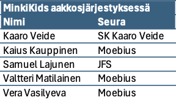

## Kids

<Wide>

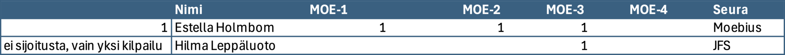

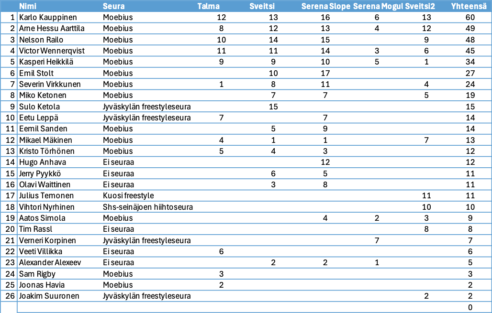

</Wide>

## Rookies

<Wide>

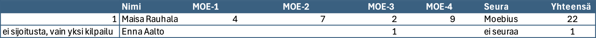

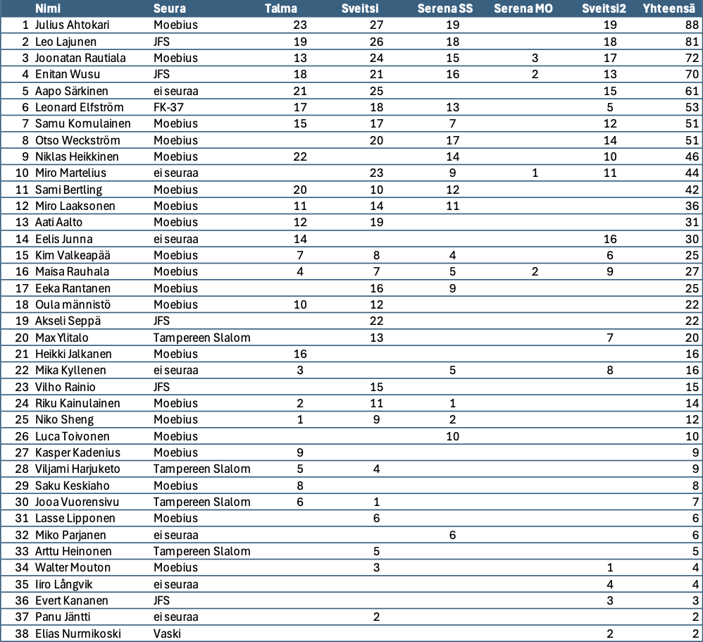

</Wide>

## Pro

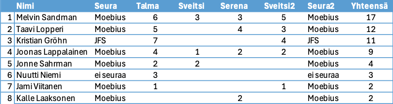

# Talma 5.4.2025

Joudumme valitettavasti perumaan SkiTourin viimeisen osakilpailun aikaisen kevään suljettua Talman ennen aikojaan.

Ensi kaudella jatketaan!​

​

**Yhteystiedot**

Heikki Rauhala, 0407692277, [info@moebius.fi,](mailto:info@moebius.fi) [moebius.fi](/), [@moebiusfreestyle](https://www.instagram.com/moebiusfreestyle/)

# Tulokset SkiTour Sveitsin Hiihtokeskus 15.3.2025

<Wide>

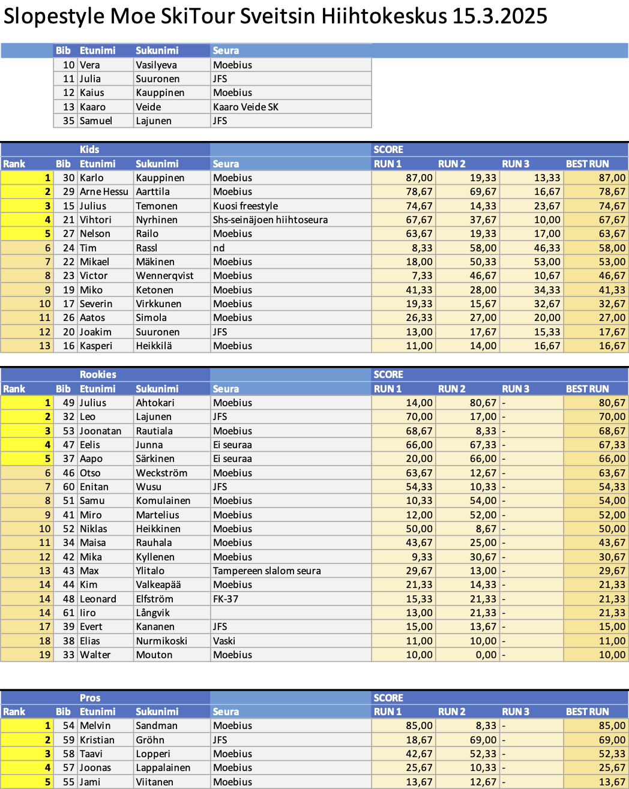

</Wide>

<Logos images={["sglogowhite.png", "d10d77_sveitsilogoboxed.png"]} />

# Fearless Finns ja Moe SkiTour Sveitsin hiihtokeskus 15.3.2025

Tervetuloa Moen järjestämään **Fearless Finns Slopestyle** kilpailuun Sveitsin hiihtokeskuksessa!

Kilpailu on osa Fearless Finns Freeski touria ja Moe SkiTouria. Kilpailu lasketaan hyppyrilinjassa, johon rakennetaan reilit ja hypyt samaan laskuun.

Fearless Finns kilpailukiertue on kansallinen kilpailukiertue ja osallistuakseen laskijalla on oltava voimassa oleva kilpailulisenssi tai Skipassi.

- Kilpailulisenssi on pakollinen kansalliseen ja sitä ylempään kilpailutoimintaan osallistuville 13 – 65 -vuotiaille (vuosina 1959 – 2012 syntyneet).
- 12-vuotiaat ja nuoremmat (vuonna 2013 ja myöhemmin syntyneet) sekä 65-vuotiaat ja vanhemmat (vuonna 1959 ja aiemmin syntyneet) Skipassi on riittävä kaikkeen kansalliseen kilpailutoimintaan.
- Yli 12-vuotiaat (vuonna 2012 ja aikaisemmin) saavat osallistua Skipassilla **oman seuransa järjestämiin** kansallisiin kilpailuihin, ei kuitenkaan SM-kilpailuihin.

Lue lisää lisenssivaihtoehdoista ja skipassista [Skisport Finlandin sivuilta](https://skisport.fi/lisenssit-skipassi/)

.

## Sarjat

Fearless Finns kisoissa kilpaillaan tyttöjen ja poikien sarjoissa ikäluokittain:

- MiniKids — 2015 tai myöhemmin syntyneet
- Kids — 2012–2014 syntyneet
- Rookie — 2009–2011 syntyneet
- Pro / Avoin

Nuorten sarjoissa palkitaan kolme parasta.

Skisportin ohjeiden mukaan MiniKids-sarjaa ei pisteytetä, vaan kaikki saavat diplomin ja henkilökohtaisen palautteen.

Huomattavaa myös että Fearless Finns Freeski tourin kisoissa sauvat ovat pakollisia Rookie ja Pro -sarjoissa. Ilman sauvoja tehdyt suoritukset pisteytetään kaatuneiksi.

​

## Ilmoittautuminen

Ilmoittautumiset keskiviikkoon 12.3.2025 mennessä [tällä nettilomakkeella](https://forms.microsoft.com/Pages/ResponsePage.aspx?id=D-3ZRPKc0kyhLtcRqv4mVbaIWDVAA2lBqAJ3amGdVSBURVcxVFI1OUk2NzNYRVpHTzVSSjI0Uk0yMSQlQCN0PWcu)

.

Kilpailu on ennakkoon ilmoittautuneille Freestyleseura Moebius ry:n jäsenille ilmainen.

Muille ennakkoilmoittautumismaksu 10 € maksetaan Freestyleseura Moebius ry:n tilille:

IBAN: FI09 8000 9710 2213 95

BIC: OKOYFIHH

Viestiin “SKITOUR4” ja ilmoittautujan nimi.

Paikan päällä viimehetken ilmoittautumismaksu kaikille 20 €.

​

## Aikataulusuunnitelma

**10.00** Lipunmyynti ja hissit aukeavat, numeroliivien jako kilpailutoimistossa hiihtokoulun mökissä

**10.15** Kilpailijakokous molemmat lajit hiihtokoulun mökin edessä

**Vapaat harjoitukset**

**11.20** Slopestyle MiniKids ja Kids, 3 laskua, paras tulos jää voimaan

**Lounas** Rinneravintolassa nopea ja ravitseva keittolounas

**13.20** Slopestyle Rookie ja Pro, 3 laskua, paras tulos jää voimaan

**15.30** Palkintojenjako rinneravintolan edessä

## Tiedottaminen ja tulospalvelu

WhatsApp-ryhmä [Fearless Freeski 2024](https://chat.whatsapp.com/DYaRLEPYxkX6n1d5xdES0G). Viralliset tulokset SSF:n nettisivuilla. Tulokset julkaistaan myös tällä nettisivulla.

## Talkoot

Tarvitsemme kilpailuiden järjestämiseen myös paljon talkooväkeä, talkooväen ilmoittautuminen [talkooväen ilmoittautumislomakkeella](https://forms.microsoft.com/Pages/ResponsePage.aspx?id=D-3ZRPKc0kyhLtcRqv4mVbaIWDVAA2lBqAJ3amGdVSBUMlJTQ1I3TDg5S1g5NFE3RUlNODI2MTlYMyQlQCN0PWcu)

.

## Hissiliput

Sveitsin hiihtokeskuksen lipunmyynnistä saat päivälipun numeroliiviä vastaan alennushintaan 32 €.

Hiihtokeskuksessa on käytössä Axess-etäkortti.

## Yhteystiedot

Heikki Rauhala, 0407692277, [info@moebius.fi,](mailto:info@moebius.fi) [moebius.fi](/), [@moebiusfreestyle](https://www.instagram.com/moebiusfreestyle/)

# Tulokset SkiTour Serena 1.3.2025

<Wide>

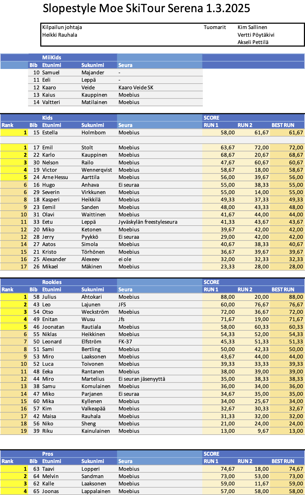

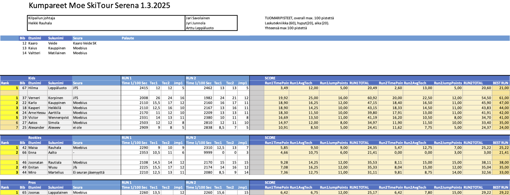

</Wide>

<Logos images={["sglogowhite.png", "serenaskiaurinkologo.png"]} />

# SkiTour Serena 1.3.2025

Tervetuloa Freestyleseura Moebius ry:n Moe SkiTour -kiertueen kolmanteen kilpailuun Serenaan lauantaina 1.3.2025 kello 10.00 alkaen!

## Kilpailu

Serenassa kilpaillaan kaksi erillistä lajia: Slopestyle ja Moguls. Molempiin lajeihin ilmoittaudutaan samalla lomakkeella jossa valitaan lajit. Kannustamme kaikkia kilpailijoita osallistumaan molempiin lajeihin, molemmat ovat matalan kynnyksen kisoja! Tulokset lajeista ovat erilliset. Molemmat lajit lasketaan myös omina kisoinaan osaksi Moe SkiTourin kokonaiskilpailua.

## Slopestyle

Päivä aloitetaan Slopestylekilpailulla. MiniKidsit laskevat ensin, jonka jälkeen Kids kokonaisuutena, ja viimeisenä Rookie ja Pro kokonaisuutena. MiniKids laskee pikkulinjassa, muut pyritään laskemaan isommassa linjassa jossa on ensin reilit ja lopussa hyppyri. ​Slopestylessä lasketaan kaksi laskua joista parempi jää voimaan. MiniKids ja Kids lasketaan ensin kokonaan jonka jälkeen Rookie ja Pro kokonaan.

## Kumpareet

Slopestylen jälkeen järjestetään kumparekilpailu lumitilanteen salliessa. Kumpareissa lasketaan kaksi laskua, parempi jää voimaan.\
Kumpareissa MiniKids ja Kids ensin molemmat kaksi laskua jonka jälkeen Rookie ja Pro kaksi laskua.

## Sarjat

SkiTourin kisoissa kilpaillaan tyttöjen ja poikien sarjoissa ikäluokittain:

- MiniKids — 2015 tai myöhemmin syntyneet
- Kids — 2012–2014 syntyneet
- Rookie — 2009–2011 syntyneet
- Pro / Avoin

Nuorten sarjoissa palkitaan kolme parasta.

Skisportin ohjeiden mukaan MiniKids-sarjaa ei pisteytetä, vaan kaikki saavat diplomin ja henkilökohtaisen palautteen.

## Ilmoittautuminen

Ilmoittautumiset keskiviikkoon 26.2.2025 [tällä nettilomakkeella](https://forms.office.com/e/we3dFiNPZy)

.

Kilpailu on ennakkoon ilmoittautuneille Freestyleseura Moebius ry:n jäsenille ilmainen.

Muille ennakkoilmoittautumismaksu 10 € maksetaan Freestyleseura Moebius ry:n tilille. Voit osallistua molempiin lajeihin yhdellä maksulla. Tässä maksutiedot:

Summa: 10€

IBAN: FI09 8000 9710 2213 95

BIC: OKOYFIHH

Viestiin “SKITOUR3” ja ilmoittautujan nimi.

Paikan päällä viimehetken ilmoittautumismaksu kaikille 20 €.

Moe SkiTourin kisoihin voivat osallistua kaikki lajia harrastavat, osallistuminen ei edellytä seurajäsenyyttä. Tarvitset välineet freestylehiihtoa varten. Kypärä ja selkäpanssari ovat pakollisia. Sauvat eivät ole Moen omissa kisoissa pakolliset, mutta ilman sauvoja laskien saa vähemmän pisteitä.

Tarvitset myös kilpailutilanteen ja parkkilaskun kattavan vakuutuksen, kuten Ski Sport Finlandin Skipassin tai kilpailulisenssin ohessa myytävän Sporttiturva-vakuutuksen. Talman kilpailuun et tarvitse lisenssiä, mutta SkiTour-kiertueella yksi kisoista on kansallisen Fearless Finns -sarjan osakilpailu, johon osallistuaksesi tarvitset Skipassin jos olet 12-vuotias tai nuorempi tai Moebiuksen jäsen, tai kilpailulisenssin. Kannattaa hankkia vakuutus ja mahdollinen lisenssi nyt kauden alussa!

Lisätietoa lisenssivaihtoehdoista [Skisport Finlandin sivuilta](https://skisport.fi/lisenssit-skipassi/).

## Aikataulusuunnitelma

**10.00** Numeroliivien jako kilpailutoimistossa

**10.15** Slopestyle kilpailijakokous

**10.30** Lipunmyynti ja hissit aukeavat (vain hissit 1 ja 2 ja parkkirinne)

**Vapaat harjoitukset**

**11.15** Slopestyle kilpailu alkaa, MiniKids ja Kids ensin, sitten Rookie ja Pro

**Lounas 13-17** vesipuiston ravintola Graninassa. Kotiruokalounas toimitsijoille ja kisaajille alennushintaan numeroliiviä vastaan erilliseltä kassalta 12,50€.

**14.30** Kumparekilpailun kilpailijakokous kumpareiden alapuolella

**15.00** Kumparekilpailu alkaa, MiniKids ja Kids ensin, sitten Rookie ja Pro

**17.00** Palkintojenjako

## Talkoot

Tarvitsemme kilpailuiden järjestämiseen myös paljon talkooväkeä, talkooväen ilmoittautuminen [talkooväen ilmoittautumislomakkeella](https://forms.office.com/e/Zypsp8RKwe)

.

## Hissiliput

Hiihtokeskuksen lipunmyynnistä saat päivälipun numeroliiviä vastaan alennushintaan 27€.

Hiihtokeskuksessa on käytössä Axess-etäkortti.

## Yhteystiedot

Heikki Rauhala, 0407692277, [info@moebius.fi,](mailto:info@moebius.fi) [moebius.fi](/), [@moebiusfreestyle](https://www.instagram.com/moebiusfreestyle/)

# Tulokset SkiTour Sveitsin Hiihtokeskus 8.2.2025

<Wide>

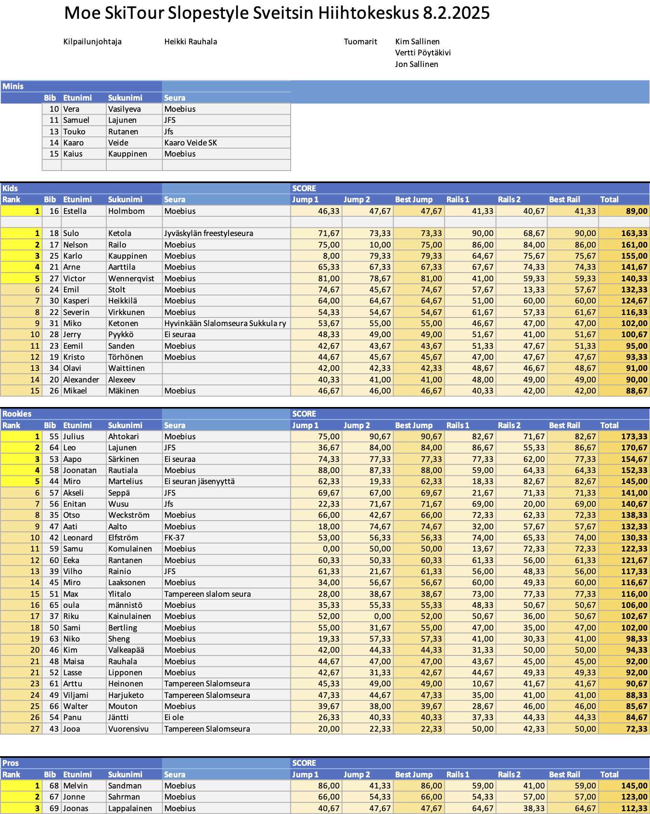

</Wide>

<Logos images={["sglogowhite.png", "d10d77_sveitsilogoboxed.png"]} />

# Talma Ski 5.4.2025

Talmassa kilpaillaan SkiTourin kauden päätösjamit Slopestylessä kelin mukaan.

# Moe SkiTour Sveitsin Hiihtokeskus 8.2.2025

Tervetuloa Freestyleseura Moebius ry:n Moe SkiTour -kilpailuun Sveitsin Hiihtokeskukseen lauantaina 8.2.2025 kello 10 alkaen.

​

## Kilpailu

Lajina on Slopestyle suksilla. Sveitsissä kilpailu lasketaan Kids, Rookies ja Pros sarjoissa kahdessa osassa:

- kaksi laskua hyppylinjassa, parempi jää voimaan
- kaksi laskua Rail Plazalla, parempi jää voimaan

MiniKidsit laskevat molemmat kilpailulaskunsa Rail Plazalla heti aamupäivällä.

Laskija voi valita suorituspaikat oman taitotasonsa mukaan. Suorituspaikkoja ja hyppyreitä löytyy kaiken tasoisille. Tuomaroitava alue ja elementit tarkennetaan kilpailijakokouksessa.

## Sarjat

SkiTourilla kilpaillaan tyttöjen ja poikien sarjoissa ikäluokittain:

- MiniKids — 2015 tai myöhemmin syntyneet
- Kids — 2012–2014 syntyneet
- Rookie — 2009–2011 syntyneet
- Pro / Avoin

Nuorten sarjoissa palkitaan kolme parasta.

Skisportin ohjeiden mukaan MiniKids-sarjaa ei pisteytetä, vaan kaikki saavat diplomin ja henkilökohtaisen palautteen.

## Ilmoittautuminen

Ilmoittautumiset keskiviikkoon 5.2.2025 mennessä [tällä nettilomakkeella](https://forms.office.com/e/J7gQTguwUR)

.

Kilpailu on ennakkoon ilmoittautuneille Freestyleseura Moebius ry:n jäsenille ilmainen.

Muille ennakkoilmoittautumismaksu 10 € maksetaan Freestyleseura Moebius ry:n tilille

FI09 8000 9710 2213 95. Viestiin “SKITOUR2” ja ilmoittautujan nimi.

Paikan päällä viimehetken ilmoittautumismaksu kaikille 20 €.

Moebiusta edustaville kisat kuuluvat edelleen jäsenmaksuun, eli Moen jäsenenä (40€), pääset koko kisakiertueelle edullisimmin.

Moe SkiTourin kisoihin voivat osallistua kaikki lajia harrastavat, osallistuminen ei edellytä seurajäsenyyttä. Tarvitset välineet freestylehiihtoa varten. Kypärä ja selkäpanssari ovat pakollisia. Sauvat eivät ole Moen omissa kisoissa pakolliset, mutta ilman sauvoja laskien saa vähemmän pisteitä.

Tarvitset myös kilpailutilanteen ja parkkilaskun kattavan vakuutuksen, kuten Ski Sport Finlandin Skipassin tai kilpailulisenssin ohessa myytävän Sporttiturva-vakuutuksen. Talman kilpailuun et tarvitse lisenssiä, mutta SkiTour-kiertueella yksi kisoista on kansallisen Fearless Finns -sarjan osakilpailu, johon osallistuaksesi tarvitset Skipassin jos olet 12-vuotias tai nuorempi tai Moebiuksen jäsen, tai kilpailulisenssin. Kannattaa hankkia vakuutus ja mahdollinen lisenssi nyt kauden alussa!

Lisätietoa lisenssivaihtoehdoista [Skisport Finlandin sivuilta](https://skisport.fi/lisenssit-skipassi/).

## Aikataulusuunnitelma

**10.00** Lipunmyynti ja hissit aukeavat, numeroliivien jako alkaa hiihtokoulun mökillä

**Vapaat harjoitukset**

**10.30** Kilpailijakokous Rail Plazan yläosassa

**10.45** MiniKids kilpailu Rail Plazalla

**11.00** Hypyt muut sarjat

**Lounas** Rinneravintolassa on tarjolla erinomaista lounasta

**13.15** MiniKids palkintojenjako ravintolan edessä

**13.30** Reilit Kids, Rookie & Avoin

**16.30** Palkintojenjako rinneravintolan edessä

## Talkoot

Tarvitsemme kilpailuiden järjestämiseen myös paljon talkooväkeä, talkooväen ilmoittautuminen [talkooväen ilmoittautumislomakkeella](https://forms.office.com/e/nNP0X0X32K)

.

## Hissiliput

Sveitsin hiihtokeskuksen vuokraamosta saat päivälipun numeroliiviä vastaan alennushintaan 32€.

Hiihtokeskuksessa on käytössä Axess-etäkortti.

## Yhteystiedot

Heikki Rauhala, 0407692277, [info@moebius.fi,](mailto:info@moebius.fi) [moebius.fi](/), [@moebiusfreestyle](https://www.instagram.com/moebiusfreestyle/)

# Tulokset Moe SkiTour Talma 18.1.2025

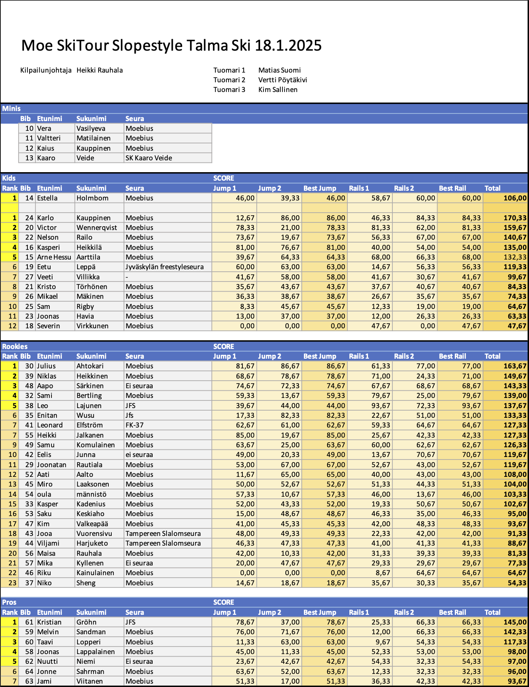

# Kilpailukutsu Moe SkiTour Talma 18.1.2025

Tervetuloa Freestyleseura Moebius ry:n Moe SkiTour -kiertueen ensimmäiseen kilpailuun Talma Ski:hin lauantaina 18.1.2025 kello 10 alkaen.

## Kilpailu

Lajina on Slopestyle suksilla. Talmassa kilpailu lasketaan Kids, Rookies ja Pro-sarjoissa kahdessa osassa:

- kaksi laskua hyppylinjassa, parempi jää voimaan
- kaksi laskua reililinjassa, parempi jää voimaan

MiniKids laskevat koko kilpailun popup-parkissa josta löytyy putki, pressiboksi ja hyppyri samasta linjasta. MiniKids laskevat molemmat kilpailulaskut

Laskija voi valita suorituspaikat oman taitotasonsa mukaan. Suorituspaikkoja ja hyppyreitä löytyy kaiken tasoisille. Tuomaroitava alue tarkennetaan kilpailijakokouksessa.

## Sarjat

SkiTourin kisoissa kilpaillaan erikseen tyttöjen ja poikien sarjoissa ikäluokittain:

- MiniKids — 2015 tai myöhemmin syntyneet
- Kids — 2012–2014 syntyneet
- Rookie — 2009–2011 syntyneet
- Pro / Avoin

Nuorten sarjoissa palkitaan kolme parasta.

Skisportin ohjeiden mukaan MiniKids-sarjaa ei pisteytetä, vaan kaikki saavat diplomin ja henkilökohtaisen palautteen.

## Ilmoittautuminen

Ilmoittautumiset keskiviikkoon 15.1.2024 mennessä [tällä nettilomakkeella](https://forms.office.com/e/i5GAnAGMTp)

.

Kilpailu on ennakkoon ilmoittautuneille Freestyleseura Moebius ry:n jäsenille ilmainen.

Muille ennakkoilmoittautumismaksu 8 € maksetaan Freestyleseura Moebius ry:n tilille:

IBAN: FI09 8000 9710 2213 95

BIC: OKOYFIHH

Viestiin “SKITOUR1” ja ilmoittautujan nimi.

Paikan päällä viimehetken ilmoittautumismaksu kaikille 12 €.

Seuraavissa kisoissa maksut nousevat ennakkoilmoittautuneille 10€ ja​ paikan päällä ilmoittautuessa 20€. Moelaisille kisat kuuluvat edelleen jäsenmaksuun, niin Moen jäseneenä (40€), pääset koko kisakiertueelle edullisimmin.

Moe SkiTourin kisoihin voivat osallistua kaikki lajia harrastavat, osallistuminen ei edellytä seurajäsenyyttä. Tarvitset välineet freestylehiihtoa varten. Kypärä ja selkäpanssari ovat pakollisia. Sauvat eivät ole Moen omissa kisoissa pakolliset, mutta ilman sauvoja laskien saa vähemmän pisteitä.

Tarvitset myös kilpailutilanteen ja parkkilaskun kattavan vakuutuksen, kuten Ski Sport Finlandin Skipassin tai kilpailulisenssin ohessa myytävän Sporttiturva-vakuutuksen. Talman kilpailuun et tarvitse lisenssiä, mutta SkiTour-kiertueella yksi kisoista on kansallisen Fearless Finns -sarjan osakilpailu, johon osallistuaksesi tarvitset Skipassin jos olet 12-vuotias tai nuorempi tai Moebiuksen jäsen, tai kilpailulisenssin. Kannattaa hankkia vakuutus ja mahdollinen lisenssi nyt kauden alussa!

Lisätietoa lisenssivaihtoehdoista [Skisport Finlandin sivuilta](https://skisport.fi/lisenssit-skipassi/).

## Aikataulusuunnitelma

**10.00** numeroliivien jako mutterissa kahvilan terassin vieressä, lipunmyynti ja hissit aukeavat.

**Vapaat harjoitukset**

**10.30** Kilpailijakokous etuparkin hissien ala-asemalla

**10.45** MiniKids-sarja popup-parkissa

**11.05** Hypyt järjestyksessä Kids, Rookie & Pro

**Lounas** Suosituksena keittolounas jota on nopeasti tarjolla, mene syömään oman hyppylaskusi jälkeen!

MiniKids palkintojenjako kun muiden sarjojen hypyt on laskettu

**13.30** Reilit järjestyksessä Kids, Rookie & Pro

**16.30** Palkintojenjako etuparkien hissien ala-asemalla

## Talkoot

Tarvitsemme kilpailuiden järjestämiseen myös paljon talkooväkeä, talkooväen ilmoittautuminen [talkooväen ilmoittautumislomakkeella](https://forms.office.com/e/YEgMySKpf5)

.

## Hissiliput

Hiihtokeskuksen lipunmyynnistä saat päivälipun numeroliiviä vastaan hintaan 30€.

Hiihtokeskuksessa on käytössä Axess-etäkortti.

## Yhteystiedot

Heikki Rauhala, 0407692277, [info@moebius.fi,](mailto:info@moebius.fi) [moebius.fi](/), [@moebiusfreestyle](https://www.instagram.com/moebiusfreestyle/), [facebook.com/moebiusfreestyle](https://www.facebook.com/moebiusfreestyle)

[Viime kauden SkiTour tapahtumat löydät täältä](/skitour-2024/).

<Logos images={["sglogowhite.png", "talmaglacier.png"]} />
