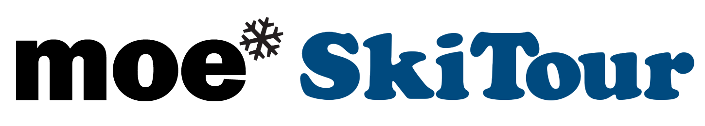

# Kilpailukutsu Moe SkiTour Talma 28.3.2026

Tervetuloa Freestyleseura Moebius ry:n Moe SkiTour-kiertueen päätöskilpailuun Talma Ski:hin lauantaina 28.3.2026 kello 10 alkaen. Vaikka kausi alkaa olla lopuillaan, järjestetään kilpailu, kunhan hissit pyörivät.

## Kilpailu

Tämänhetkinen suunnitelma on pitää parhaan tempun kisa yhdestä hyppyristä ja yhdestä reilistä. Talmassa kilpailu lasketaan Groms, Rookies ja Open-sarjoissa kahdessa osassa:

- kaksi hyppyä, parempi jää voimaan
- kaksi reiliä, parempi jää voimaan

Kaikki luokat lasketaan etuparkissa.

Laskija voi valita suorituspaikat oman taitotasonsa mukaan. Suorituspaikkoja ja hyppyreitä löytyy kaiken tasoisille. Käytettävä hyppyri ja reilit vahvistetaan viimeistään kilpailijakokouksessa.

## Luokat

Tällä kaudella kilpaillaan lajiliiton uuden ikäryhmäjaon mukaan. Ikäryhmät ovat yhdenmukaisia Fearless Finns Freestyle Tourin kanssa. Kids tytöt ja -pojat laskevat samassa luokassa. Muissa ikäryhmissä on tyttöjen ja poikien luokat.

**Kids — 2014 syntyneet ja nuoremmat**

Tässä luokassa ei ole rankingia, vaan kaikki saavat tuomareilta kirjallisen palautteen suorituksistaan.\
Halutessaan Kids-ikäinen saa kilpailla Groms-luokassa. Kids-luokka lasketaan pienemmässä parkissa kuin muut luokat.

**Groms — syntymävuodet 2013 – 2011**

Halutessaan nuorempi kuin 2013 syntynyt saa kilpailla tässä luokassa. Fearless Finns -kiertueella 2013 tai myöhemmin syntyneen joka osallistuu Groms-luokkaan on kilpailtava koko kausi ko. luokassa. Moen kisoissa nuoremmat voivat ilmoittautua kisakohtaisesti.

**Rookie — syntymävuodet 2010 – 2008**

**Open — syntymävuosi 2010 tai aiemmin**\
Tässä luokassa kilpailevat kaikki FIS-koodilaskijat, jos kilpailu on FIS-kilpailu.\
2010–2008 syntyneillä on mahdollisuus kilpailla myös Rookie-luokassa, mutta silloin he eivät saa FIS-pisteitä.

## Ilmoittautuminen

Ilmoittautuminen keskiviikkoon 25.3.2026 mennessä [tällä nettilomakkeella](https://forms.microsoft.com/e/6qDQenL8Gv)

.

Kilpailu on ennakkoon ilmoittautuneille Freestyleseura Moebiusta edustaville seuran jäsenille ilmainen.

Seuran ulkopuolisille ennakkoilmoittautumismaksu on 15 €. Jälki-ilmoittautuminen paikan päällä maksaa 25€.

Ilmoittautumismaksut maksetaan Freestyleseura Moebius ry:n tilille\
FI09 8000 9710 2213 95\
Viestiin “SKITOUR1” tai "KOKO SKITOUR" ja ilmoittautujan nimi.

Moe SkiTourin kisoihin voivat osallistua kaikki lajia harrastavat. Osallistuminen ei edellytä seurajäsenyyttä. Tarvitset välineet freestylehiihtoa varten. Kypärä ja selkäpanssari ovat pakollisia. Sauvat eivät ole Moen omissa kisoissa pakolliset, mutta ilman sauvoja laskien saa vähemmän pisteitä.

Tarvitset myös kilpailutilanteen ja parkkilaskun kattavan vakuutuksen, kuten Ski Sport Finlandin Skipassin tai kilpailulisenssin ohessa myytävän Sporttiturva-vakuutuksen. Talman kilpailuun et tarvitse lisenssiä.

Lisätietoa lisenssivaihtoehdoista [Skisport Finlandin sivuilta](https://skisport.fi/lisenssit-skipassi/).

## Aikataulusuunnitelma

**9.30** numeroliivien jako mutterissa kahvilan terassin vieressä,

**10.00** hissit aukeavat.

**Vapaat harjoitukset**

**10.30** Kilpailijakokous etuparkin hissien ala-asemalla

**10.45** Hypyt

**Lounas:** suosituksena keittolounas, joka on nopeasti tarjolla.

**13.00** Reilit

**15.00** Palkintojenjako etuparkien hissien ala-asemalla

## Talkoot

Tarvitsemme kilpailuiden järjestämiseen myös paljon talkooväkeä. Talkooväen ilmoittautuminen [talkooväen ilmoittautumislomakkeella](https://forms.microsoft.com/e/3JAQ19wVEs)

.

## Hissiliput

Hiihtokeskuksen lipunmyynnistä saat päivälipun numeroliiviä vastaan alennushinnalla.

Hiihtokeskuksessa on käytössä Axess-etäkortti.

## Yhteystiedot

Heikki Rauhala, 0407692277, [info@moebius.fi,](mailto:info@moebius.fi) [moebius.fi](/), [@moebiusfreestyle](https://www.instagram.com/moebiusfreestyle/), [facebook.com/moebiusfreestyle](https://www.facebook.com/moebiusfreestyle)

<Logos images={["sglogowhite.png", "talmaglacier.png"]} />

# Kokonaiskilpailun tulokset ennen Talman viimeistä kisaa

## Rookie

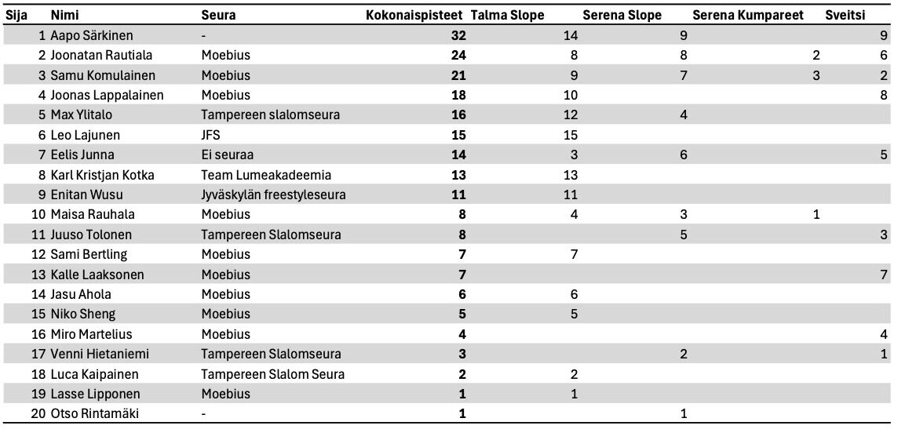

## Groms

<Wide>

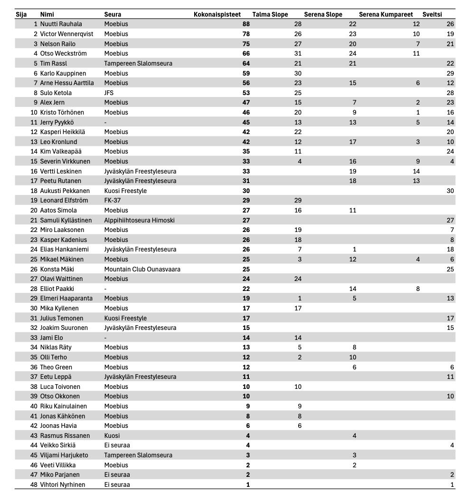

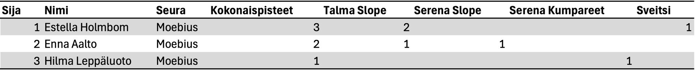

</Wide>

## Kids

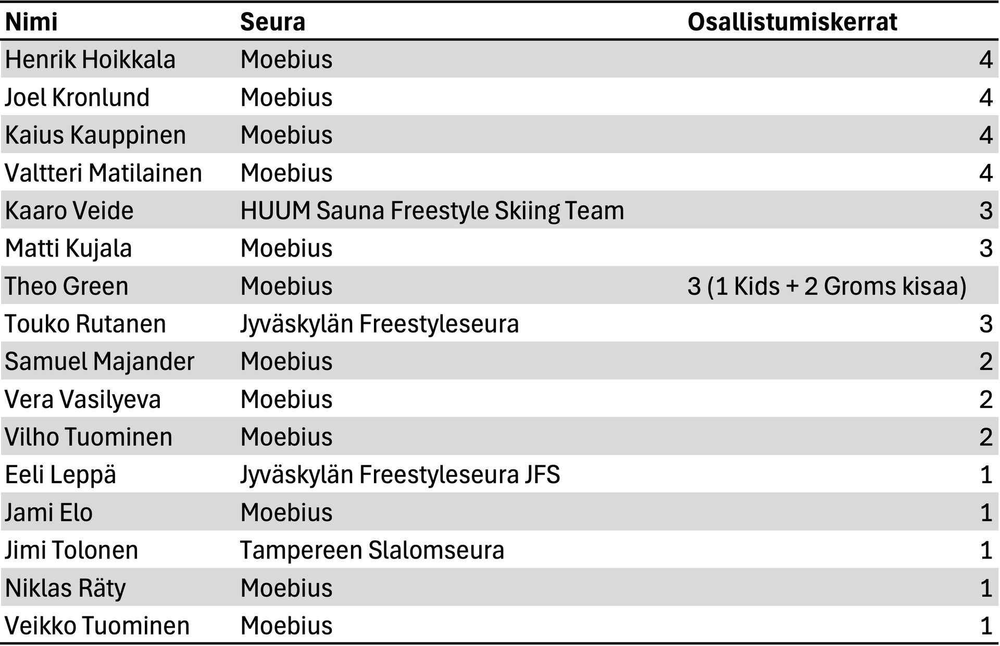

# Tulokset Sveitsin Hiihtokeskus 7.3.2026

<Wide>

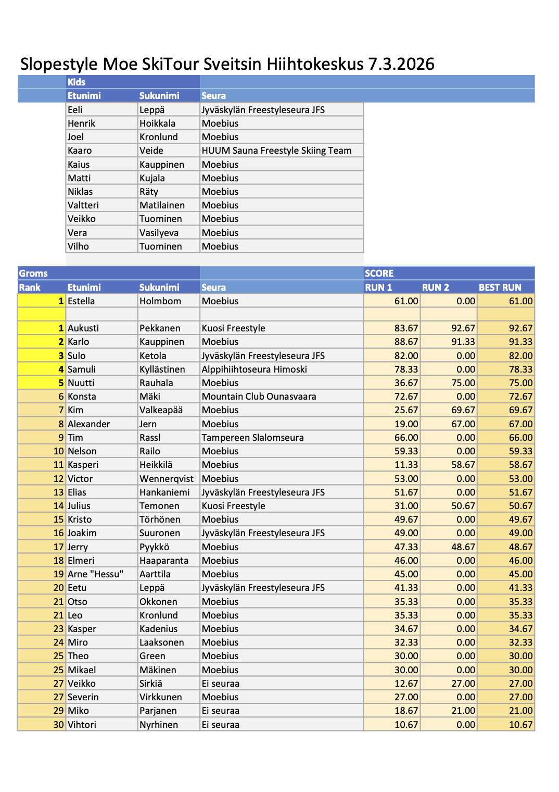

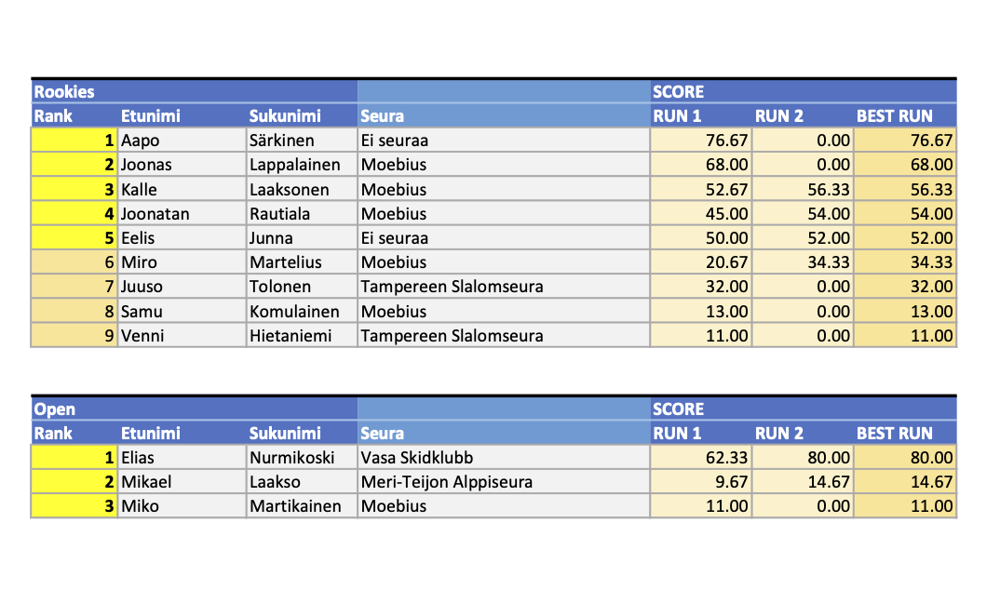

</Wide>

# Fearless Finns ja Moe SkiTour Sveitsin hiihtokeskus 7.3.2026

Tervetuloa Moen järjestämään **Fearless Finns Slopestyle** kilpailuun Sveitsin hiihtokeskuksessa!

Kilpailu on osa Fearless Finns Freeski touria ja Moe SkiTouria. Kilpailu lasketaan hyppyrilinjassa, johon rakennetaan reilit ja hypyt samaan laskuun.

## Luokat

Tällä kaudella kilpaillaan lajiliiton uuden ikäryhmäjaon mukaan. Ikäryhmät ovat yhdenmukaiset Fearless Finns Freestyle tourin kanssa. Kids tytöt ja -pojat laskevat samassa luokassa, muissa ikäryhmissä on tyttöjen ja poikien luokat.

**Kids — 2014 syntyneet ja nuoremmat**

Tässä luokassa ei rankingia vaan kaikki saavat tuomareilta kirjallisen palautteen suorituksistaan.\
Halutessaan Kids ikäinen saa kilpailla Groms luokassa. Kids luokka lasketaan pienemmässä parkissa kuin muut luokat.

**Groms — syntymävuodet 2013 – 2011**

Halutessaan nuorempi kuin 2013 syntynyt saa kilpailla tässä luokassa. Fearless Finns kiertueella 2013 tai myöhemmin syntyneen joka osallistuu Groms sarjaan on kilpailtava koko kausi ko. luokassa. Moen kisoissa nuoremmat voivat ilmoittautua kisakohtaisesti.

**Rookie — syntymävuodet 2010 – 2008**

**Open — syntymävuosi 2010 tai aiemmin**\
Tässä luokassa kilpailevat kaikki FIS-koodi laskijat, jos kilpailu on FIS kilpailu.\
2010-2008 syntyneillä on mahdollisuus kilpailla myös Rookie luokassa, mutta silloin he eivät saa FIS\
pisteitä.

Huomattavaa myös että Fearless Finns Freeski tourin kisoissa sauvat ovat pakollisia Rookie ja Pro -sarjoissa. Ilman sauvoja tehdyt suoritukset pisteytetään kaatuneiksi.

​

## Ilmoittautuminen

Ilmoittautumiset keskiviikkoon 4.3.2026 mennessä [**tällä lomakkeella**](https://forms.office.com/e/5rPfKTqmRj).

Kilpailu on ennakkoon ilmoittautuneille Moebiusta edustaville Freestyleseura Moebius ry:n jäsenille ilmainen.

Tällä kaudella seuran ulkopuolisille on tarjolla kaikki neljä kilpailua kattava SkiTour-pakettihinta 40 €, tai kisakohtainen ennakkoilmoittautumismaksu 15 €. Jälki-ilmoittautuminen paikan päällä maksaa 25€.

Ilmoittautumismaksut maksetaan Freestyleseura Moebius ry:n tilille\
FI09 8000 9710 2213 95\
Viestiin “SKITOUR3” tai "KOKO SKITOUR" ja ilmoittautujan nimi.

Fearless Finns kilpailukiertue on kansallinen kilpailukiertue ja osallistuakseen laskijalla on oltava voimassa oleva kilpailulisenssi tai Skipassi.

- Kilpailulisenssi on pakollinen kansalliseen ja sitä ylempään kilpailutoimintaan osallistuville 13<strong>–</strong>65 -vuotiaille (vuosina 1962<strong>–</strong>2013 syntyneet).
- 12-vuotiaat ja nuoremmat (vuonna 2014 ja myöhemmin syntyneet) Skipassi on riittävä kaikkeen kansalliseen kilpailutoimintaan.
- Yli 12-vuotiaat (vuonna 2013 ja aikaisemmin) saavat osallistua Skipassilla **oman seuransa järjestämiin** kansallisiin kilpailuihin, ei kuitenkaan SM-kilpailuihin.
- Ulkomaalaiset voivat osallistua kilpailuun ilman lisenssiä täyttämällä vastuuvapauslomakkeen.

Lue lisää lisenssivaihtoehdoista ja Skipassista [Skisport Finlandin sivuilta](https://skisport.fi/lisenssit-skipassi/).

​

## Aikataulusuunnitelma

**9.40** Lipunmyynti ja hissit aukeavat, numeroliivien jako kilpailutoimistossa hiihtokoulun mökissä

**9.55** Kilpailijakokous molemmat lajit hiihtokoulun mökin edessä

**10.00 Vapaat harjoitukset**

**11.20** Slopestyle Kids, Rookie ja Open, 2 laskua, paras tulos jää voimaan

**Lounas** Rinneravintolassa nopea ja ravitseva keittolounas

**13.00** Slopestyle Groms, 2 laskua, paras tulos jää voimaan

**15.30** Palkintojenjako rinneravintolan edessä

## Tiedottaminen ja tulospalvelu

WhatsApp-ryhmä [Fearless Freeski 2026](https://chat.whatsapp.com/DYaRLEPYxkX6n1d5xdES0G). Viralliset tulokset SSF:n nettisivuilla. Tulokset julkaistaan myös tällä nettisivulla.

## Talkoot

Tarvitsemme kilpailuiden järjestämiseen myös paljon talkooväkeä, talkooväen ilmoittautuminen [talkooväen ilmoittautumislomakkeella](https://forms.office.com/e/i4kCWRADRz)

.

## Hissiliput

Sveitsin hiihtokeskuksen lipunmyynnistä saat päivälipun numeroliiviä vastaan alennushintaan.

Hiihtokeskuksessa on käytössä Axess-etäkortti.

## Yhteystiedot

Heikki Rauhala, 0407692277, [info@moebius.fi,](mailto:info@moebius.fi) [moebius.fi](/), [@moebiusfreestyle](https://www.instagram.com/moebiusfreestyle/)

<Logos images={["sglogowhite.png", "d10d77_sveitsilogoboxed.png"]} />

# Tulokset Moe SkiTour Serena 7.2.2026

<Wide>

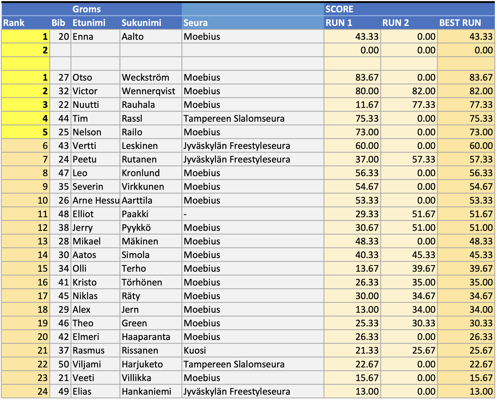

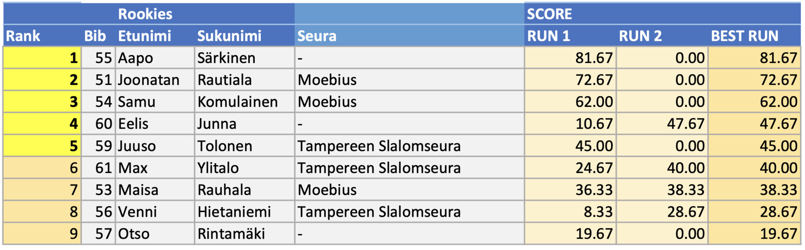

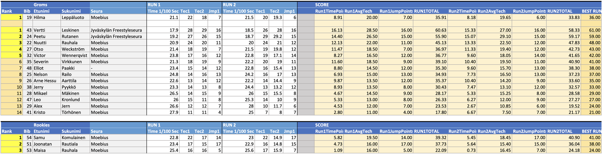

</Wide>

# SkiTour Serena 7.2.2026

Tervetuloa Freestyleseura Moebius ry:n Moe SkiTour -kiertueen kolmanteen kilpailuun Serenaan lauantaina 7.2.2026 kello 10.00 alkaen!

## Kilpailu

Serenassa kilpaillaan kaksi erillistä lajia: Slopestyle ja Moguls. Molempiin lajeihin ilmoittaudutaan samalla lomakkeella jossa valitaan lajit. Kannustamme kaikkia kilpailijoita osallistumaan molempiin lajeihin, molemmat ovat matalan kynnyksen kisoja! Tulokset lajeista ovat erilliset. Molemmat lajit lasketaan myös omina kisoinaan osaksi Moe SkiTourin kokonaiskilpailua.

## Slopestyle

Päivä aloitetaan Slopestylekilpailulla. Kidsit laskevat ensin, jonka jälkeen Groms kokonaisuutena, ja viimeisenä Rookies ja open kokonaisuutena. Kidsit laskevat pikkulinjassa, muut pyritään laskemaan isommassa linjassa jossa on ensin reilit ja lopussa hyppyri. ​Slopestylessä lasketaan kaksi laskua joista parempi jää voimaan.

## Kumpareet

Slopestylen jälkeen järjestetään kumparekilpailu lumitilanteen salliessa. Kumpareissa lasketaan kaksi laskua, parempi jää voimaan.\
Kumpareissa lasketaan kaksi laskua ja osanottajamäärästä riippuen luokat erikseen tai yhdessä.

## Luokat

Tällä kaudella kilpaillaan lajiliiton uuden ikäryhmäjaon mukaan. Ikäryhmät ovat yhdenmukaiset Fearless Finns Freestyle tourin kanssa. Kids tytöt ja -pojat laskevat samassa luokassa, muissa ikäryhmissä on tyttöjen ja poikien luokat.

**Kids — 2014 syntyneet ja nuoremmat**

Tässä luokassa ei rankingia vaan kaikki saavat tuomareilta kirjallisen palautteen suorituksistaan.\
Halutessaan Kids ikäinen saa kilpailla Groms luokassa. Kids luokka lasketaan pienemmässä parkissa kuin muut luokat.

**Groms — syntymävuodet 2013 – 2011**

Halutessaan nuorempi kuin 2013 syntynyt saa kilpailla tässä luokassa. Fearless Finns kiertueella 2013 tai myöhemmin syntyneen joka osallistuu Groms sarjaan on kilpailtava koko kausi ko. luokassa. Moen kisoissa nuoremmat voivat ilmoittautua kisakohtaisesti.

**Rookie — syntymävuodet 2010 – 2008**

**Open — syntymävuosi 2010 tai aiemmin**\
Tässä luokassa kilpailevat kaikki FIS-koodi laskijat, jos kilpailu on FIS kilpailu.\
2010-2008 syntyneillä on mahdollisuus kilpailla myös Rookie luokassa, mutta silloin he eivät saa FIS\
pisteitä.

## Ilmoittautuminen

Ilmoittautumiset keskiviikkoon 4.2.2026 mennessä [tällä nettilomakkeella](https://forms.office.com/e/940rjANURB)

.

Kilpailu on ennakkoon ilmoittautuneille Moebiusta edustaville Freestyleseura Moebius ry:n jäsenille ilmainen.

Tällä kaudella seuran ulkopuolisille on tarjolla kaikki neljä kilpailua kattava SkiTour-pakettihinta 40 €, tai kisakohtainen ennakkoilmoittautumismaksu 15 €. Jälki-ilmoittautuminen paikan päällä maksaa 25€.

Ilmoittautumismaksut maksetaan Freestyleseura Moebius ry:n tilille\
FI09 8000 9710 2213 95\
Viestiin “SKITOUR1” tai "KOKO SKITOUR" ja ilmoittautujan nimi.

Moe SkiTourin kisoihin voivat osallistua kaikki lajia harrastavat, osallistuminen ei edellytä seurajäsenyyttä. Tarvitset välineet freestylehiihtoa varten. Kypärä ja selkäpanssari ovat pakollisia. Sauvat eivät ole Moen omissa kisoissa pakolliset, mutta ilman sauvoja laskien saa vähemmän pisteitä.

Tarvitset myös kilpailutilanteen ja parkkilaskun kattavan vakuutuksen, kuten Ski Sport Finlandin Skipassin tai kilpailulisenssin ohessa myytävän Sporttiturva-vakuutuksen. Talman kilpailuun et tarvitse lisenssiä, mutta SkiTour-kiertueella yksi kisoista on kansallisen Fearless Finns -sarjan osakilpailu, johon osallistuaksesi tarvitset Skipassin jos olet 12-vuotias tai nuorempi tai Moebiuksen jäsen, tai kilpailulisenssin. Kannattaa hankkia vakuutus ja mahdollinen lisenssi nyt kauden alussa!

Lisätietoa lisenssivaihtoehdoista [Skisport Finlandin sivuilta](https://skisport.fi/lisenssit-skipassi/).

## Aikataulusuunnitelma

**10.00** Numeroliivien jako kilpailutoimistossa

**10.15** Slopestyle kilpailijakokous

**10.30** Lipunmyynti ja hissit aukeavat (vain hissit 1 ja 2 ja parkkirinne)

**Vapaat harjoitukset**

**11.15** Slopestyle kilpailu alkaa, Kids ensin, sitten Groms ja Rookies

**Lounas 13-17** vesipuiston ravintola Graninassa. Kotiruokalounas toimitsijoille ja kisaajille alennushintaan numeroliiviä vastaan erilliseltä kassalta 12,50€.

**14.30** Kumparekilpailun kilpailijakokous kumpareiden alapuolella

**15.00** Kumparekilpailu alkaa, Kids ensin, sitten Groms ja Rookies

**17.00** Palkintojenjako

## Talkoot

Tarvitsemme kilpailuiden järjestämiseen myös paljon talkooväkeä, talkooväen ilmoittautuminen [talkooväen ilmoittautumislomakkeella](https://forms.office.com/e/8Wz9qX1Sch)

.

## Hissiliput

Hiihtokeskuksen lipunmyynnistä saat päivälipun numeroliiviä vastaan alennushintaan.

Hiihtokeskuksessa on käytössä Axess-etäkortti.

## Yhteystiedot

Heikki Rauhala, 0407692277, [info@moebius.fi,](mailto:info@moebius.fi) [moebius.fi](/), [@moebiusfreestyle](https://www.instagram.com/moebiusfreestyle/)

<Logos images={["sglogowhite.png", "serenaskiaurinkologo.png"]} />

# Tulokset Moe SkiTour Talma 17.1.2026

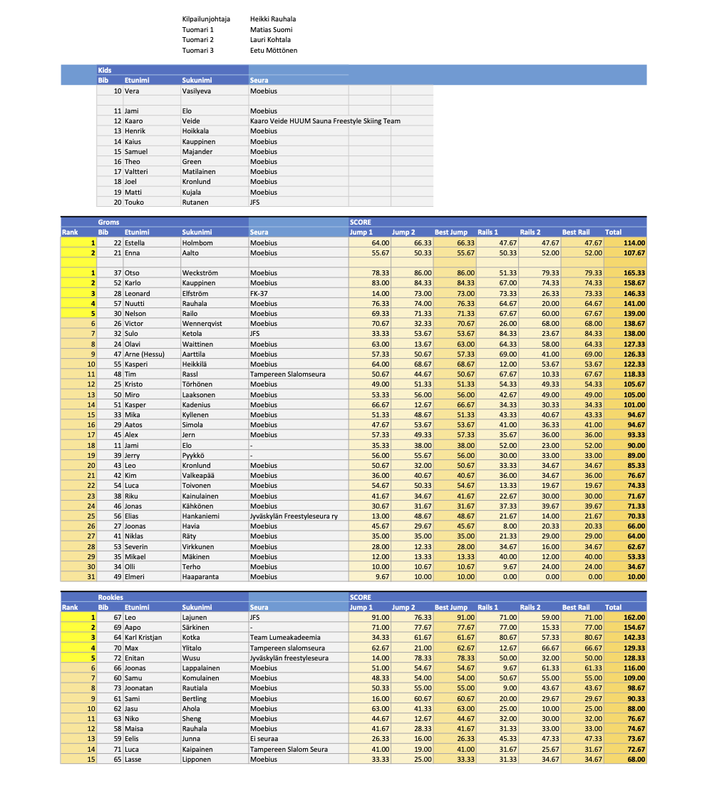

# Kilpailukutsu Moe SkiTour Talma 17.1.2026

Tervetuloa Freestyleseura Moebius ry:n Moe SkiTour -kiertueen ensimmäiseen kilpailuun Talma Ski:hin lauantaina 17.1.2026 kello 10 alkaen.

## Kilpailu

Lajina on Slopestyle suksilla. Talmassa kilpailu lasketaan Groms, Rookies ja Open-sarjoissa kahdessa osassa:

- kaksi laskua hyppylinjassa, parempi jää voimaan
- kaksi laskua reililinjassa, parempi jää voimaan

Kids-luokan kilpailu lasketaan joko popup-parkissa tai takaparkissa jos se ehtii valmistua kisoihin mennessä.

Laskija voi valita suorituspaikat oman taitotasonsa mukaan. Suorituspaikkoja ja hyppyreitä löytyy kaiken tasoisille. Tuomaroitava alue tarkennetaan kilpailijakokouksessa.

## Luokat

Tällä kaudella kilpaillaan lajiliiton uuden ikäryhmäjaon mukaan. Ikäryhmät ovat yhdenmukaiset Fearless Finns Freestyle tourin kanssa. Kids tytöt ja -pojat laskevat samassa luokassa, muissa ikäryhmissä on tyttöjen ja poikien luokat.

**Kids — 2014 syntyneet ja nuoremmat**

Tässä luokassa ei rankingia vaan kaikki saavat tuomareilta kirjallisen palautteen suorituksistaan.\
Halutessaan Kids ikäinen saa kilpailla Groms luokassa. Kids luokka lasketaan pienemmässä parkissa kuin muut luokat.

**Groms — syntymävuodet 2013 – 2011**

Halutessaan nuorempi kuin 2013 syntynyt saa kilpailla tässä luokassa. Fearless Finns kiertueella 2013 tai myöhemmin syntyneen joka osallistuu Groms sarjaan on kilpailtava koko kausi ko. luokassa. Moen kisoissa nuoremmat voivat ilmoittautua kisakohtaisesti.

**Rookie — syntymävuodet 2010 – 2008**

**Open — syntymävuosi 2010 tai aiemmin**\
Tässä luokassa kilpailevat kaikki FIS-koodi laskijat, jos kilpailu on FIS kilpailu.\
2010-2008 syntyneillä on mahdollisuus kilpailla myös Rookie luokassa, mutta silloin he eivät saa FIS\
pisteitä.

## Ilmoittautuminen

Ilmoittautumiset keskiviikkoon 14.1.2026 mennessä [tällä nettilomakkeella](https://forms.office.com/Pages/ResponsePage.aspx?id=D-3ZRPKc0kyhLtcRqv4mVbaIWDVAA2lBqAJ3amGdVSBUOUhFVlVFNzlQNkxKVjdZUThHR0hCVVo4TyQlQCN0PWcu)

.

Kilpailu on ennakkoon ilmoittautuneille Freestyleseura Moebiusta edustaville seuran jäsenille ilmainen.

Tällä kaudella seuran ulkopuolisille on tarjolla kaikki neljä kilpailua kattava SkiTour-pakettihinta 40 €, tai kisakohtainen ennakkoilmoittautumismaksu 15 €. Jälki-ilmoittautuminen paikan päällä maksaa 25€.

Ilmoittautumismaksut maksetaan Freestyleseura Moebius ry:n tilille\
FI09 8000 9710 2213 95\
Viestiin “SKITOUR1” tai "KOKO SKITOUR" ja ilmoittautujan nimi.

Moe SkiTourin kisoihin voivat osallistua kaikki lajia harrastavat, osallistuminen ei edellytä seurajäsenyyttä. Tarvitset välineet freestylehiihtoa varten. Kypärä ja selkäpanssari ovat pakollisia. Sauvat eivät ole Moen omissa kisoissa pakolliset, mutta ilman sauvoja laskien saa vähemmän pisteitä.

Tarvitset myös kilpailutilanteen ja parkkilaskun kattavan vakuutuksen, kuten Ski Sport Finlandin Skipassin tai kilpailulisenssin ohessa myytävän Sporttiturva-vakuutuksen. Talman kilpailuun et tarvitse lisenssiä, mutta SkiTour-kiertueella yksi kisoista on kansallisen Fearless Finns -sarjan osakilpailu, johon osallistuaksesi tarvitset Skipassin jos olet 12-vuotias tai nuorempi tai Moebiuksen jäsen, tai kilpailulisenssin.

Kannattaa hankkia vakuutus ja mahdollinen lisenssi nyt kauden alussa! Skipassiin lisättävä sporttiturva vakuutus on hyvin edullinen freeski-vakuutus.

Lisätietoa lisenssivaihtoehdoista [Skisport Finlandin sivuilta](https://skisport.fi/lisenssit-skipassi/).

## Aikataulusuunnitelma

**10.00** numeroliivien jako mutterissa kahvilan terassin vieressä, lipunmyynti ja hissit aukeavat.

**Vapaat harjoitukset**

**10.30** Kilpailijakokous etuparkin hissien ala-asemalla

**10.45** Kids-sarja popup-parkissa

**11.10** Hypyt: Groms, Rookie & Open

**Lounas** Suosituksena keittolounas jota on nopeasti tarjolla, mene syömään oman hyppylaskusi jälkeen!

MiniKids palkintojenjako kun muiden sarjojen hypyt on laskettu

**13.30** Reilit: Groms, Rookie & Open

**16.30** Palkintojenjako etuparkien hissien ala-asemalla

## Talkoot

Tarvitsemme kilpailuiden järjestämiseen myös paljon talkooväkeä, talkooväen ilmoittautuminen [talkooväen ilmoittautumislomakkeella](https://forms.office.com/Pages/ResponsePage.aspx?id=D-3ZRPKc0kyhLtcRqv4mVbaIWDVAA2lBqAJ3amGdVSBURDEzOU1NWDRHTzhKOVFETTBRMFhQMkhFNCQlQCN0PWcu)

.

## Hissiliput

Hiihtokeskuksen lipunmyynnistä saat päivälipun numeroliiviä vastaan alennushinnalla.

Hiihtokeskuksessa on käytössä Axess-etäkortti.

## Yhteystiedot

Heikki Rauhala, 0407692277, [info@moebius.fi,](mailto:info@moebius.fi) [moebius.fi](/), [@moebiusfreestyle](https://www.instagram.com/moebiusfreestyle/), [facebook.com/moebiusfreestyle](https://www.facebook.com/moebiusfreestyle)

<Logos images={["sglogowhite.png", "talmaglacier.png"]} />

# SkiTour 2026

Moe SkiTour jatkuu keväällä 2026 neljän osakilpailun voimin:

- 17.1. Talma Ski — Slopestyle
- 7.2. Serena Ski — Slopestyle ja kumpareet
- 7.3. Sveitsin Hiihtokeskus — Slopestyle kilpailu joka on myös osa [Fearless Finns Freestyle touria](https://skisport.fi/tapahtumat/fearless-finns-freeski-tour/)
- 28.3. Talma Ski — Slopestyle

Kilpailuissa kilpaillaan tällä kaudella lajiliiton uuden ikäryhmäjaon mukaan. Ikäryhmät ovat yhdenmukaiset Fearless Finns Freestyle tourin ja muiden pohjoismaiden kilpailujen kanssa.

**Kids — 2014 syntyneet ja nuoremmat**

Tässä luokassa ei rankingia vaan kaikki saavat tuomareilta kirjallisen palautteen suorituksistaan.\
Halutessaan Kids ikäinen saa kilpailla Groms luokassa.

**Groms — syntymävuodet 2013 – 2011**

Halutessaan nuorempi kuin 2013 syntynyt saa kilpailla tässä luokassa, mutta hänen on silloin kilpailtava\
koko kausi ko. luokassa.

**Rookie — syntymävuodet 2010 – 2008**

**Open — syntymävuodet 2010 tai aiemmin**\
Tässä luokassa kilpailevat kaikki FIS-koodi laskijat, jos kilpailu on FIS kilpailu.\
2010-2008 syntyneillä on mahdollisuus kilpailla myös Rookie luokassa, mutta silloin he eivät saa FIS\
pisteitä.

**Yhteystiedot**

Heikki Rauhala, 0407692277, [info@moebius.fi,](mailto:info@moebius.fi) [moebius.fi](/), [@moebiusfreestyle](https://www.instagram.com/moebiusfreestyle/)

# Menneet kaudet

Videoita edellisen kauden SkiTourilta löytyy [Moen YouTubesta](https://www.youtube.com/@MoebiusFreestyle).

[Kauden 2025 SkiTour](/skitour-2025/)\
[Kauden 2024 SkiTour](/skitour-2024/)

<Logos images={["sglogowhite.png", "talmaglacier.png", "serenaskiaurinkologo.png", "sveitsilogoboxed.png"]} />
