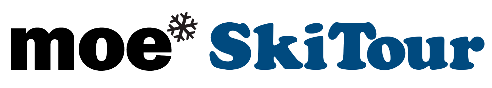

# SkiTour 2027

Moe SkiTour jatkuu keväällä 2027 neljän osakilpailun voimin:

- 16.1. Talma Ski — Slopestyle
- 6.2. Serena Ski — Slopestyle ja kumpareet
- 6.3. Sveitsin Hiihtokeskus — Slopestyle
- 3.4. Talma Ski — Slopestyle

**Kids — 2015 syntyneet ja nuoremmat**

Tässä luokassa ei ole rankingia vaan kaikki saavat tuomareilta kirjallisen palautteen suorituksistaan.\
Halutessaan Kids-ikäinen saa kilpailla Groms-luokassa.

**Groms — syntymävuodet 2014 – 2012**

Halutessaan nuorempi kuin 2014 syntynyt saa kilpailla tässä luokassa, mutta hänen on silloin kilpailtava\
koko kausi ko. luokassa.

**Rookie — syntymävuodet 2011 – 2009**

**Open — syntymävuodet 2011 tai aiemmin**\
Tässä luokassa kilpailevat kaikki FIS-koodilliset laskijat, jos kilpailu on FIS-kilpailu.\
2011-2009 syntyneillä on mahdollisuus kilpailla myös Rookie-luokassa, mutta silloin he eivät saa FIS-pisteitä.

**Yhteystiedot**

Heikki Rauhala, 0407692277, [info@moebius.fi](mailto:info@moebius.fi), [moebius.fi](/), [@moebiusfreestyle](https://www.instagram.com/moebiusfreestyle/)

# Menneet kaudet

Videoita edellisen kauden SkiTourilta löytyy [Moen YouTubesta](https://www.youtube.com/@MoebiusFreestyle).

[Kauden 2026 SkiTour](/skitour-2026/)\
[Kauden 2025 SkiTour](/skitour-2025/)\
[Kauden 2024 SkiTour](/skitour-2024/)

<Logos images={["sglogowhite.png", "talmaglacier.png", "serenaskiaurinkologo.png", "sveitsilogoboxed.png"]} />
